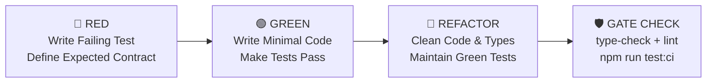

# ANTIGRAVITY.md

Orientation and architectural guide for Antigravity agents working in this repository.

## Project Overview

**玄機AI XuanJi** — Full-stack AI-powered Chinese divination platform. Supports 7 deterministic Chinese divination systems plus modular fallbacks:
- **BaZi (八字)** — Four Pillars of Destiny (V2 engine powered by `tyme4ts`)
- **Zi Wei Dou Shu (紫微斗數)** — Purple Star Astrology (powered by `iztro`)
- **I Ching (易經)** — Book of Changes (`taobi`)
- **Liu Yao (六爻)** — Six Lines Hexagram Divination
- **Qi Men Dun Jia (奇門遁甲)** — Mysterious Gates Escaping Technique
- **Feng Shui (風水)** — Nine Palaces Flying Stars (玄空九星)
- **Mei Hua (梅花易數)** — Plum Blossom Divination (Time-based & Birth-based)
- **Other / Fallback** — Generic birth profile & event inquiries

Key capabilities:
- **Deterministic Calculators**: Chart calculation and astronomical algorithms are deterministic TypeScript (`src/lib/*Calculator.ts`).
- **AI Interpretations**: Structured interpretations generated via OpenRouter (`openai` SDK) or local Claude proxy (`@anthropic-ai/sdk`), guided by prompt references in `divination-refs/*.md`.
- **Xuanji Master (玄機大師)**: Persistent, proactive chat assistant with long-term memory, incremental user portrait extraction, and session compression (`src/lib/master/`).
- **Credit & Payment System**: Unified credit economy (Karma points), Stripe checkout/subscriptions, daily bonus grants, and gift links.
- **Onboarding Ad Funnel**: 5-step interactive funnel (`/start`) converting tentative visitors into registered users with trial credits.
- **Bilingual**: English and Traditional Chinese (`zh-TW`) via `src/components/LanguageContext.tsx` and `src/lib/i18n/`.
- **Multi-Platform**: Responsive Web + Android mobile app via Capacitor 8.

---

## Tech Stack & Verified Versions

| Category | Technology | Verified Version | Notes |
| :--- | :--- | :--- | :--- |
| **Framework** | Next.js | `^14.2.35` | App Router only; standalone Docker output |
| **Runtime / Language** | Node.js / TypeScript | Node 20 LTS / TS `^5` | Strict mode enabled; ESNext target |
| **Database & ORM** | PostgreSQL + Prisma | Prisma `^6.0.0` | 25 models; binary targets: native, windows, debian-openssl-3.0.x |
| **Authentication** | NextAuth.js | `^5.0.0-beta.25` | Credentials provider, JWT sessions, bcryptjs `^2.4.3` |
| **AI Integration** | OpenRouter + Claude SDK | `openai` `^6.27.0`, `@anthropic-ai/sdk` `^0.37.0` | Unified via `src/lib/llm/` |
| **Styling & Animation** | Tailwind CSS + Framer Motion | Tailwind `^3.3.0`, Framer Motion `^11.0.0` | Custom colors: navy, gold, jade, vermillion |
| **UI Components** | React 18 | `^18` | react-hot-toast `^2.4.1`, react-markdown `^9.0.0`, remark-gfm `^4.0.0` |
| **Divination Engines** | tyme4ts, iztro, lunar-typescript, taobi | `tyme4ts` `^1.4.5`, `iztro` `^2.5.8`, `lunar-typescript` `^1.8.6`, `taobi` `^0.4.5` | `tyme4ts` is primary for BaZi V2 |
| **Payments & Emails** | Stripe + Resend | `stripe` `^20.4.1`, `@stripe/stripe-js` `^8.11.0`, `resend` `^6.9.4` | Webhooks handled via `/api/stripe/webhook` |
| **Monitoring & Logging**| Sentry + Pino | `@sentry/nextjs` `^10.57.0`, `pino` `^10.3.1` | Edge, server & client Sentry; structured pino logging |
| **Schema & Validation**| Zod + jsonrepair | `zod` `^4.3.6`, `jsonrepair` `^3.14.0` | Zod defines single source of truth for LLM prompts & schemas |
| **Mobile Wrapper** | Capacitor | `@capacitor/*` `^8.3.0` | Android platform, push notifications, native biometrics |
| **Testing** | Vitest | `^4.1.1` | 41 test suites, 1,074 automated tests |

---

## Development & Operational Commands

### Package Scripts (`package.json`)

```bash
# Dependency Management
npm install                  # Install dependencies

# Development Server
npm run dev                  # prisma generate && prisma migrate deploy && next dev on 0.0.0.0:8088

# Building & Production Run
npm run build                # Build Next.js standalone bundle
npm start                    # Start production server (standalone server via start.js in Docker)

# Quality Checks & Pre-deployment Gate
npm run type-check           # Typecheck codebase without emitting (tsc --noEmit)
npm run lint                 # Run Next.js ESLint (next lint)
npm run predeploy-check      # Full pre-deploy verification: type-check + lint + test:ci

# Testing Suites (Vitest)
npm test                     # Run Vitest in interactive watch mode
npm run test:ci              # Run all 41 test suites non-interactively (vitest run)
npm run test:unit            # Run fast unit tests only (excludes src/__tests__/integration/**)
npm run test:integration     # Run integration tests only (vitest run integration)

# Database Operations (Prisma)
npm run db:generate          # Regenerate Prisma Client (prisma generate)
npm run db:migrate           # Interactive migration development (prisma migrate dev)
npm run db:push              # ⚠️ WARNING: Local throwaway DBs ONLY; drifts migration history
npm run db:backup            # Execute DB snapshot backup (node db_backup/backup.mjs)
npm run db:restore           # Restore DB from snapshot (node db_backup/restore.mjs)
```

### Shell & Integration Scripts (`tests/` & `scripts/`)

```bash
# Automated Shell Integration Suites
./tests/run_tests.sh         # Comprehensive API & integration suite (defaults to BASE_URL=http://localhost:8094)
BASE_URL=http://localhost:8088 ./tests/run_tests.sh  # Run against local dev server
./tests/run_funnel_tests.sh  # End-to-end /start ad funnel test suite (cookie-jar session tests)

# Database & Administration Utilities
./scripts/setup-db.sh        # Initialize local PostgreSQL container/service
./scripts/make-admin.sh      # Promote a given user email to admin role
./scripts/smoke-test-api.mjs # Standalone smoke tests for API endpoints
./scripts/check-i18n.sh      # Validate i18n key consistency between zh and en
./scripts/verify-famous-bazi.ts # Validate historical charts against BaZi calculator
```

---

## Workspace Directory Structure

```
├── .claude/                 # Claude settings & worktrees
├── .env.example             # Comprehensive environment variable template
├── Dockerfile               # Multi-stage Docker build (deps -> builder -> prisma-cli -> runner)
├── android/                 # Capacitor Android native project
├── capacitor.config.ts      # Capacitor configuration (appId: com.chinese.divination, remote server URL)
├── db_backup/               # Backup and restore utilities (backup.mjs, restore.mjs)
├── divination-refs/         # Markdown prompt references loaded dynamically by LLM layer
│   ├── bazi.md  ziwei.md  iching.md  qimen.md  liuyao.md  fengshui.md  others.md  master.md
│   └── master-appendices/   # activation.md, reflection.md, templates.md
├── docs/                    # Architecture notes, migration recovery runbooks, design proposals
├── next.config.js           # Next.js config (standalone output, serverRuntimeConfig: 600s maxDuration)
├── package.json             # Pinned dependencies and scripts
├── prisma/
│   ├── schema.prisma        # 25 models (User, Reading, MasterChatMessage, UserPortrait, etc.)
│   └── migrations/          # 33 migration steps (strict migration history)
├── public/                  # Static assets, fonts, icons, banners
├── scripts/                 # Maintenance, smoke testing, admin, and migration helper scripts
├── sentry.edge.config.ts    # Edge runtime Sentry initialization
├── sentry.server.config.ts  # Node.js server runtime Sentry initialization
├── start.js                 # Production bootstrapper: extends HTTP timeouts (660s) & runs migrations
├── tailwind.config.js       # Custom design tokens (navy, gold, jade, vermillion)
├── tests/                   # Shell integration test suites (run_tests.sh, run_funnel_tests.sh)
├── tsconfig.json            # Path alias: @/* -> ./src/*
├── vitest.config.ts         # Vitest configuration (testTimeout: 30000ms, alias: @/*)
└── src/
    ├── __tests__/           # Top-level integration tests (creditReservation.test.ts, masterChat.test.ts)
    ├── instrumentation.ts   # Next.js startup hook: Sentry init & starts in-process job scheduler
    ├── middleware.ts        # Next.js edge middleware
    ├── types/               # TypeScript declarations (divination.ts, master.ts, next-auth.d.ts)
    ├── hooks/               # Custom React hooks (useMasterChat.ts, useDragScroll.ts)
    ├── components/          # Reusable UI components
    │   ├── master/          # Master chat widget (CollapsedBar, ExpandedView, MasterFab, Context)
    │   ├── results/         # Divination result views (BaziResultV2, ZiweiResultV2, SectionDrawer, etc.)
    │   ├── start/           # 5-step onboarding ad funnel components
    │   └── Navbar.tsx, Footer.tsx, LanguageContext.tsx, SentryClientInit.tsx, etc.
    ├── app/                 # Next.js App Router (pages and API endpoints)
    │   ├── (auth)/          # Authentication routes (login, register, forgot-password)
    │   ├── (divination)/    # Divination entry pages
    │   ├── (legal)/         # Privacy policy, terms of service
    │   ├── admin/           # Admin dashboard (logs, users, settings, master-debug, wiki, funnel)
    │   ├── dashboard/       # User profile and reading history
    │   ├── start/           # Interactive onboarding funnel
    │   ├── r/ & reading/    # Reading viewer and short-link share redirection
    │   └── api/             # 29 API route groups:
    │       ├── admin/       # 19 admin endpoints (logs, stats, users, master-debug, etc.)
    │       ├── divination/  # Core divination generation endpoint & streaming handlers
    │       │   ├── handlers/ # Modular handlers (personal/ & event/) + _streamingJsonParser.ts
    │       │   └── schemas/  # Zod schemas for divination types + _toLLMTemplate.ts
    │       ├── master/      # Xuanji Master chat SSE streaming endpoint & tool runner
    │       ├── start/       # Funnel init, unlock, and conversion endpoints
    │       └── auth, chat, claim, credits, gift, notifications, profile, share, stripe, etc.
    └── lib/                 # Core domain logic
        ├── baziCalculator.ts    # Deterministic BaZi calculator V2 (tyme4ts)
        ├── ziweiCalculator.ts   # Deterministic ZiWei calculator (iztro)
        ├── ichingCalculator.ts  # Deterministic I Ching calculator (taobi)
        ├── qimenCalculator.ts   # Qi Men Dun Jia deterministic calculator
        ├── liuyaoCalculator.ts  # Liu Yao deterministic calculator
        ├── meihuaCalculator.ts  # Mei Hua deterministic calculator
        ├── fengshuiCalculator.ts# Feng Shui 9-palace flying star calculator
        ├── env.ts               # Startup environment variable validation with Zod
        ├── logger.ts            # Structured Pino logger
        ├── prisma.ts            # Global Prisma Client singleton
        ├── readings/            # Reading lifecycle service & atomic credit hold/refund machine
        ├── jobs/                # In-process scheduled jobs (log retention, stale cleaner)
        ├── llm/                 # Unified LLM provider abstraction (OpenRouter, Claude proxy)
        └── master/              # Xuanji Master agent engine (tools, memory, portrait, compression)
```

---

## Architecture & Domain Subsystems

### 1. Unified LLM Abstraction Layer (`src/lib/llm/`)

All AI calls route through `completeLLM()` (blocking) or `streamLLM()` (SSE streaming with function calling):
- **Provider Routing**:
  - `openrouter.ts`: Primary provider using the `openai` SDK with `https://openrouter.ai/api/v1`.
  - `claudeProxy.ts`: Local CLI proxy for blocking Anthropic calls.
- **Config Resolution Fallback Chain** (`settings.ts`):
  1. Explicit caller override (`CompletionRequest.model` / `reasoningEffort`)
  2. `AdminSetting` database row (60s TTL cache; clear via `clearLLMSettingsCache()`)
  3. Environment variables (`OPENROUTER_MODEL`, `MASTER_MODEL`, `DIVINATION_REASONING_EFFORT`, etc.)
  4. Hardcoded defaults:
     - Divination: `anthropic/claude-3-5-haiku` (Reasoning: `medium`, Max tokens: 8,192, Timeout: 240s)
     - Master Chat: `openai/gpt-4o` (Reasoning: `low`, Max tokens: 8,192, Timeout: 240s)
     - Master Background: `openai/gpt-4o-mini` (Reasoning: `off`, Max tokens: 1,500)
- **JSON Enforcement**: Divination calls pass `responseFormat: { type: 'json_object' }`. If a model rejects this parameter, one automatic retry without it is executed. Escape hatch: `DIVINATION_JSON_MODE=off`.
- **Streaming Parser**: Real-time chunk repair and progressive section emitting via `_streamingJsonParser.ts` and `jsonrepair`.

### 2. Xuanji Master Agent Engine (`src/lib/master/`)

Xuanji Master is a persistent assistant operating via SSE streaming (`/api/master`):
- **Safety Boundary**: The Master is strictly read-only. It **never** computes readings directly, **never** deducts credits, and **never** mutates profile/family state. Writes are delegated to UI forms via prefilled URLs or reading cards.
- **Seven Registered Tools** (`src/lib/master/tools/`):
  1. `get_user_profile`: Returns user's birth data and completion status.
  2. `list_family_members`: Returns stored family members with relations and completeness.
  3. `list_readings`: Fetches metadata-only list of past readings.
  4. `get_reading`: Returns compact header + list of fetchable section keys (via slicers).
  5. `get_reading_detail`: Retrieves specific section content on demand (progressive disclosure).
  6. `prefill_divination_form`: Constructs a URL navigation CTA card with prefilled query parameters.
  7. `show_reading_card`: Renders a validated, interactive card linking to an existing reading.
- **Progressive Slicers** (`slicers/`): Slices stored reading JSON into small headers and on-demand sections to prevent context explosion (`bazi.ts`, `ziwei.ts`, `_identity.ts`).
- **Composite Skills** (`skills/`): 7 multi-step workflows injected into the prompt (`bazi_hepan`, `gua_ming_hu_can`, `xing_ming_he_can`, `ze_ri`, `ying_qi`, `kai_yun`, `feng_shui_tiao_li`).
- **Memory & Portrait System**:
  - `MasterChatMessage`: Relational message storage with session IDs, turns, and soft archiving.
  - `UserPortrait`: Incremental profile extractor extracting user tone, preferences, and life context.
  - `compression.ts`: Replaces older conversational turns with synthetic summary stubs when token counts swell.
  - `AdminAccessLog`: Audit logging for admin debug access into user chat and portrait state.

### 3. Divination Handlers & Validation (`src/app/api/divination/`)

- **Handler Registry**: Dispatches requests via `selectHandler(ctx)`. Handlers are split into `personal/` (birth-profile based: BaZi, ZiWei, Other) and `event/` (time/inquiry based: QiMen, LiuYao, MeiHua, FengShui, I Ching).
- **Zod Schema System** (`schemas/`):
  - Single source of truth: `schemaToLLMTemplate()` walks Zod schemas to generate structured JSON prompt templates.
  - Permissive validation: Uses `schema.passthrough().safeParse()`. Partial outputs with valid `sections` or `interpretation` are preserved rather than discarding valuable readings.
  - Hard rejects occur only if both `sections` and `interpretation` are missing; held credits are refunded on hard reject.

### 4. Reading Lifecycle & Credit Reservation (`src/lib/readings/lifecycle.ts`)

- **Atomic Reservation**: When `/api/init` begins a reading, credits are reserved (`Reading.creditsHeld`).
- **State Transitions**:
  - `pending` ──`markCompleted()`──▶ `completed` (hold finalized as consumed payment).
  - `pending` ──`markFailed()`─────▶ `failed` (hold refunded exactly once).
  - `pending` ──`cleanupStale()`───▶ `failed` (automatic refund for pending readings older than 15 minutes).
- **Concurrency Safety**: Atomic `UPDATE ... RETURNING creditsHeld` guarantees that race conditions between client aborts, error handlers, and stale cleaners never refund credits twice.

### 5. In-Process Background Job Scheduler (`src/instrumentation.ts` & `src/lib/jobs/`)

- Enabled in Next.js 14 via `experimental.instrumentationHook = true` in `next.config.js`.
- Bootstraps once per server process in the Node.js runtime (`src/lib/jobs/index.ts`).
- Runs periodic maintenance (`logRetention.ts`):
  - Scrubs PII from `LlmLog` rows older than 90 days.
  - Purges `AuthLog` rows older than 365 days.
  - Supports dry-run inspection via `LOG_PURGE_DRY_RUN=1`.

---

## Database Schema & Prisma Conventions

There are **25 models** in `prisma/schema.prisma`:
1. `User` — Main user account, auth credentials, tentative funnel state, credits, and Stripe subscription status.
2. `Reading` — Divination records, calculation payload, LLM prompt/output, and held credits.
3. `ReadingFeedback` — User ratings (1-5) and text feedback per reading.
4. `FamilyMember` — Additional birth profiles for synastry or family readings.
5. `RateLimit` — Sliding window request tracking per user/tier.
6. `ShareLink` — Shareable invite tokens granting bonus credits.
7. `LlmLog` — Token counts, latencies, system/user prompts, and request IDs.
8. `AdminSetting` — Dynamic runtime key-value configuration overrides.
9. `SiteFeedback` — General platform feedback and bug reports.
10. `Compensation` — Credit grant tokens for system error apologies.
11. `AuthLog` — Login, registration, and logout security audits.
12. `FrontendError` — Client-side error telemetry reported back to server.
13. `Notification` — System-wide or targeted multi-language announcements.
14. `NotificationRead` — Per-user notification read markers.
15. `DeviceToken` — Push notification tokens for Capacitor mobile clients.
16. `CreditLog` — Immutable audit trail of all credit grants, holds, and deductions.
17. `WikiArticle` — Divination encyclopedic articles and guides.
18. `GiftLink` — Campaign/admin links granting claimable credits.
19. `GiftClaim` — Claim history for gift links.
20. `WelcomeRule` — Dynamic welcome banner messages based on user experience stage.
21. `MasterSession` — Master assistant session counters (credits used, timezone offset).
22. `MasterChatMessage` — Individual message rows for the Master assistant.
23. `UserPortrait` — Long-term user preferences and synthesized traits.
24. `UserPortraitHistory` — Versioned audit log of portrait modifications.
25. `AdminAccessLog` — Audit trail for administrative inspection of user master data.

### Critical Database Migration Rules

- **Always use Prisma Migrate**: `npx prisma migrate dev --name <migration_name>`.
- **Commit all migration files**: Every change to `prisma/schema.prisma` must be accompanied by its generated migration SQL in `prisma/migrations/`.
- **NEVER run `prisma db push` on dev or prod**: `db push` mutates schemas without recording migration history, causing schema drift. (The `npm run db:push` command is wrapped with a loud warning).
- **Production Migrations**: Handled automatically in `start.js` before server startup via `node prisma-cli/node_modules/prisma/build/index.js migrate deploy`. If a migration fails, the container fails fast and halts boot.
- **Reference**: Review `docs/prisma-migrations-recovery.md` if schema drift or migration table poisoning occurs.

---

## Environment Configuration (`.env.example` / `src/lib/env.ts`)

Validated at boot by `src/lib/env.ts` (fails fast in production, warns in development, skipped during test/build):

### Required in Production
- `DATABASE_URL`: PostgreSQL connection string.
- `NEXTAUTH_SECRET`: Secret for signing session JWTs (`openssl rand -base64 32`).
- `NEXTAUTH_URL`: Canonical site origin (e.g. `https://chinese-divination.com`). All email links are constructed strictly from this value to prevent host header poisoning.
- `OPENROUTER_API_KEY`: OpenRouter API key for LLM queries.
- `STRIPE_SECRET_KEY`: Stripe secret API key.
- `STRIPE_WEBHOOK_SECRET`: Secret for verifying Stripe webhook events.
- `RESEND_API_KEY`: API key for transactional emails via Resend.

### Optional Overrides
- `EMAIL_FROM`: Sender address (default: `noreply@chinese-divination.com`).
- `CLAUDE_PROXY_URL`: Local Claude CLI proxy endpoint.
- `OPENROUTER_MODEL`, `MASTER_MODEL`, `PORTRAIT_MODEL`: Model name overrides.
- `DIVINATION_REASONING_EFFORT`, `CHAT_REASONING_EFFORT`, `MASTER_REASONING_EFFORT`, `MASTER_BACKGROUND_REASONING_EFFORT`: Reasoning levels (`low`, `medium`, `high`, `off`).
- `DIVINATION_JSON_MODE`: Set to `off` to disable provider-level JSON enforcement.
- `MASTER_SESSION_STALE_HOURS`: Inactivity hours before a master chat session auto-resets.
- `LOG_LEVEL`: Pino logger severity (`trace`, `debug`, `info`, `warn`, `error`, `fatal`).
- `LOG_PURGE_DRY_RUN`: Set to `1` to test log retention row counts without deleting.
- `SENTRY_DSN`, `NEXT_PUBLIC_SENTRY_DSN`: Sentry project DSNs.

---

## Testing & Verification Guidelines

- **Vitest Suite**: 41 test files covering 1,074 tests.
  - Run all tests: `npm run test:ci`
  - Run unit tests: `npm run test:unit`
  - Run integration tests: `npm run test:integration`
- **Pre-Deploy Check**: Run `npm run predeploy-check` to verify TypeScript (`type-check`), ESLint (`lint`), and test suites (`test:ci`) before pushing code.
- **Test Locations**:
  - Core Calculators & Algorithms: `src/lib/__tests__/`
  - LLM Module: `src/lib/llm/__tests__/`
  - Master Agent & Slicers: `src/lib/master/__tests__/`, `src/lib/master/slicers/__tests__/`, `src/lib/master/tools/__tests__/`, `src/lib/master/systemPrompt/__tests__/`
  - Divination Handlers & Streaming Parser: `src/app/api/divination/handlers/__tests__/`
  - Output Schemas & Templates: `src/app/api/divination/schemas/__tests__/`
  - UI Rehydration: `src/app/divination/[type]/__tests__/`
  - Integration Tests: `src/__tests__/integration/` (Credit reservations and multi-turn chat)
- **New Divination Types**:
  1. Define Zod output schema in `src/app/api/divination/schemas/{type}.schema.ts`.
  2. Implement `DivinationHandler` in `src/app/api/divination/handlers/personal/` or `event/`.
  3. Register handler in `src/app/api/divination/handlers/index.ts`.
  4. Add snapshot/schema tests verifying `schemaToLLMTemplate()` output.
  5. Colocate unit tests under `__tests__/`.

---

## Test-Driven Development (TDD) Engineering Standard

All bug fixes, feature extensions, and algorithm updates must strictly adhere to the project's **Test-Driven Development (TDD)** lifecycle.

### Core Lifecycle: Red-Green-Refactor



1. **🔴 RED**: Write a focused, deterministic unit/integration test *before* altering any source code. Run the test and verify it fails for the expected reason (e.g., function not found, assertion mismatch, edge case failure).
2. **🟢 GREEN**: Implement the minimum production code necessary to turn the test green. Do not over-engineer at this step.
3. **🔵 REFACTOR**: Clean up implementation, deduplicate logic, enforce TypeScript types and code style without altering functional behavior. Ensure all tests stay green.
4. **🛡️ GATE**: Run `npm run predeploy-check` (`type-check` + `lint` + `test:ci`) before committing.

---

### Five Iterations of Expert Optimization (针对玄機AI项目特性的五轮专家级迭代演进)

To ensure TDD is not treated as mere dogma but is tailored to Chinese metaphysics, LLM streaming, financial state machines, and Next.js fullstack architecture, this standard has undergone **five rounds of expert review and optimization**:

#### 迭代 1：确定性命理排盘算法 TDD 标准 (Deterministic Algorithm Engine)
- **挑战与背景**：八字、紫微斗数、梅花易数等推算依赖中国古天文干支纪年法与易经六十四卦数理变换，规则繁复，极其忌讳经验主义编码。
- **最佳实践落地**：
  1. **基准测试盘（Ground-Truth Fixtures）**：每一个算法必须建立标准黄金测试集（如：1988-09-17 子时男命、1990-05-15 巳时女命、2000-01-01 Y2K纪元、2020-02-29 闰年闰月日、1988 夏季夏令时、乌鲁木齐与上海经纬度真太阳时时差）。
  2. **边缘情况全覆盖（Boundary Matrix）**：
     - 早晚子时分界点：`23:00`（夜子时）与 `00:00`（早子时）日柱与时柱分界校验；
     - 节气交节瞬间：交节日前后 1 分钟大运与月柱归属；
     - 起卦取模边界：如梅花易数被 8 整除（余0）时取坤8卦、动爻被 6 整除（余0）时取上爻（第6爻）。
  3. **纯函数无副作用断言**：所有 `*Calculator.ts` 必须保证是纯函数（Pure Function），禁止在排盘层引入任何网络 I/O、数据库访问或未初始化的外部系统时间依赖。

#### 迭代 2：LLM 结构化契约与容错流式解析 TDD 标准 (LLM Contract & Streaming Parser)
- **挑战与背景**：LLM 具有随机性且耗时昂贵，单元测试若直连真实公网 API 会导致测试缓慢、不稳定且消耗 token 成本。
- **最佳实践落地**：
  1. **零外部网络依赖（Zero-Network Unit Tests）**：单元测试严禁直连 OpenRouter 或 Claude。
  2. **Schema 与 Prompt 单一可信源校验**：所有生成模板测试必须调用 `schemaToLLMTemplate(schema)`，验证其生成的 JSON 骨架包含必要的 `sections` 与 `interpretation` 字段。
  3. **宽松解析防御性测试（Permissive Fallback Tests）**：为 Zod safeParse 编写容错用例，断言当 LLM 返回包含轻微非标键值（如 markdown 代码块包裹、缺少次要字段）时，系统绝不抛出 500 丢弃结果，而是回退保留核心内容。
  4. **流式增量修复测试**：针对 `_streamingJsonParser.ts` 编写分段 chunk 注入测试（模拟在引号中截断、括号未闭合、大段 markdown 插入），断言流式解析器能在各个截断点正确修复并逐节发出渲染事件。

#### 迭代 3：金融级积分与状态机并发安全 TDD 标准 (Credit Machine & Concurrency)
- **挑战与背景**：积分（Karma）涉及用户真实支付（Stripe），网络异常、客户端中途断开或恶意并发点击若处理不当，易导致积分多扣或超额白嫖。
- **最佳实践落地**：
  1. **并发防超扣压测（Parallel Race-Condition Testing）**：
     - 测试用例必须使用 `Promise.all` 模拟 $N=10$ 个并发请求对仅剩 1 次额度的账户发起 `holdCredits()`；
     - 断言：**严格仅有 1 个成功**，其余 9 个干净拒绝；
     - 断言：数据库中的 `credits` 余额在任何时刻均 $\ge 0$。
  2. **幂等退款生命周期测试（Idempotency & Lifecycle）**：
     - 测试 `markFailed()` 与 `refundHold()` 在同一 reading 上连续调用多次，断言退款仅执行且只记账一次；
     - 处于 `completed` 状态的 reading 绝不允许被退款。
  3. **测试数据隔离与自愈（Test Fixture Isolation）**：
     - 集成测试生成以 `process.pid` 和随机数命名的临时用户与账单，`afterAll` 中必须完整回滚删除，避免测试脏数据污染测试库。

#### 迭代 4：Next.js 全栈路由与双语组件交互 TDD 标准 (Fullstack App Router & i18n)
- **挑战与背景**：Next.js 14 App Router 具有 Server Actions、Route Handlers、动态路由与 Client Component 混合的复杂性。
- **最佳实践落地**：
  1. **API Handlers 请求上下文 Mock**：
     - 测试 Route Handlers 时，构造标准 `NextRequest`，包含 query params、json body 和 header；
     - Mock `auth()` 会话上下文，针对未登录（401）、非管理员访问（403）及合法调用（200）分别编写三类独立断言。
  2. **双语对齐测试（Bilingual Parity）**：
     - 每次新增或修改前端文案与选项，必须在 `src/lib/i18n/` 或翻译字典中检查并测试 `zh-TW` 与 `en` 双语键存在性，严禁出现英文化界面显示生硬拼音（如修正 `"Paipan only"` 为 `"Chart Only"`）。
  3. **交互 Hook 状态机测试**：
     - 对 `useMasterChat` 等异步流式 hook，通过模拟 SSE event stream（`text/event-stream`）测试 `idle -> streaming -> done -> error` 状态流转。

#### 迭代 5：性能预算、CI 自动化门禁与 GitHub Issue 闭环标准 (Performance & Delivery Loop)
- **挑战与背景**：测试集膨胀容易拖慢开发反馈循环；代码修改与 Issue 追踪脱节容易产生信息孤岛。
- **最佳实践落地**：
  1. **单测耗时性能预算（Performance Budget）**：
     - 单个基础算法单元测试执行耗时必须 $< 50\text{ms}$；
     - 全套 1,000+ 单元测试总执行时间控制在 $30\text{s}$ 预算内，严禁在常规单测中引入耗时几十秒的多重遍历大循环；大样本全量 cross-validation 抽离至专项回归套件。
  2. **本地预提交门禁（Pre-deploy Gate）**：
     - 代码合并前必须本地执行 `npm run predeploy-check`（`type-check` + `lint` + `test:ci`），全部通过方可提交。
  3. **GitHub Issue 交付闭环标准**：
     - 开发分支命名规范：`fix/issue-{number}-{description}` 或 `feat/issue-{number}-{description}`；
     - 完成代码与测试并通过回归后，使用 GitHub CLI 规范回帖：
       ```bash
       gh issue comment {number} --body "【修复/实现说明】... 【测试覆盖情况】..."
       gh issue close {number} --reason "completed"
       ```

