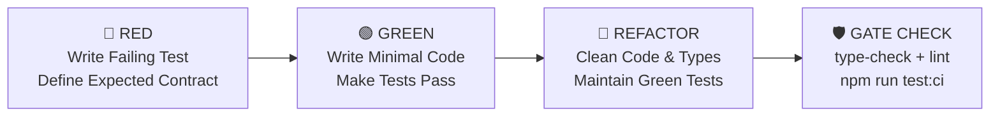

# ANTIGRAVITY.md

Orientation and architectural guide for **Google Antigravity** and **OpenCode** agents working in this repository.

> **Companion SOP**: For mandatory delivery quality gates, dev/build `.next` cache isolation rules, and module guard test tables, see [`AGENTS.md`](AGENTS.md).

## Project Overview

**XuanJi AI** — Full-stack Neuro-Symbolic AI platform for traditional Chinese metaphysical and calendrical systems. Supports 7 deterministic calculation engines plus modular fallbacks:
- **BaZi** — Four Pillars of Destiny (V2 engine powered by `tyme4ts`)
- **Zi Wei Dou Shu** — Purple Star Astrology (powered by `iztro`)
- **I Ching** — Book of Changes (`taobi`)
- **Liu Yao** — Six Lines Hexagram Divination
- **Qi Men Dun Jia** — Mysterious Gates Escaping Technique
- **Feng Shui** — Nine Palaces Flying Stars (Xuan Kong Flying Stars)
- **Mei Hua** — Plum Blossom Divination (Time-based & Birth-based)
- **Other / Fallback** — Generic birth profile & event inquiries

Key capabilities:
- **Deterministic Calculators**: Chart calculation and astronomical algorithms are 100% deterministic TypeScript (`src/lib/*Calculator.ts`).
- **AI Interpretations**: Structured interpretations generated via OpenRouter (`openai` SDK) or local Claude proxy (`@anthropic-ai/sdk`), guided by prompt references in `divination-refs/*.md`.
- **Xuanji Master**: Persistent, proactive multi-agent orchestrator with long-term memory, incremental user portrait extraction, and token-budgeted working-memory compression (`src/lib/master/`).
- **Credit & Payment System**: Unified credit economy (Karma points), Hold-then-Settle atomic ledger, Stripe checkout/subscriptions, daily bonus grants, and gift links.
- **Onboarding Ad Funnel**: 5-step interactive funnel (`/start`) converting tentative visitors into registered users with trial credits.
- **Bilingual**: English and Traditional Chinese (`zh-TW`) via `src/components/LanguageContext.tsx` and `src/lib/i18n/`.
- **Multi-Platform**: Responsive Web + Android mobile app via Capacitor 8.

---

## Tech Stack & Verified Versions

| Category | Technology | Verified Version | Notes |
| :--- | :--- | :--- | :--- |
| **Framework** | Next.js | `^14.2.35` | App Router only; standalone Docker output |
| **Runtime / Language** | Node.js / TypeScript | Node 20 LTS / TS `^5` | Strict mode enabled; ESNext target |
| **Database & ORM** | PostgreSQL + Prisma | Prisma `^6.0.0` | 25 models; binary targets: native, windows, debian-openssl-3.0.x |
| **Authentication** | NextAuth.js | `^5.0.0-beta.25` | Credentials provider, JWT sessions, bcryptjs `^2.4.3` |
| **AI Integration** | OpenRouter + Claude SDK | `openai` `^6.27.0`, `@anthropic-ai/sdk` `^0.37.0` | Unified via `src/lib/llm/` |
| **Styling & Animation** | Tailwind CSS + Framer Motion | Tailwind `^3.3.0`, Framer Motion `^11.0.0` | Custom colors: navy, gold, jade, vermillion |
| **UI Components** | React 18 | `^18` | react-hot-toast `^2.4.1`, react-markdown `^9.0.0`, remark-gfm `^4.0.0` |
| **Divination Engines** | tyme4ts, iztro, lunar-typescript, taobi | `tyme4ts` `^1.4.5`, `iztro` `^2.5.8`, `lunar-typescript` `^1.8.6`, `taobi` `^0.4.5` | `tyme4ts` is primary for BaZi V2 |
| **Payments & Emails** | Stripe + Resend | `stripe` `^20.4.1`, `@stripe/stripe-js` `^8.11.0`, `resend` `^6.9.4` | Webhooks handled via `/api/stripe/webhook` |
| **Monitoring & Logging**| Sentry + Pino | `@sentry/nextjs` `^10.57.0`, `pino` `^10.3.1` | Edge, server & client Sentry; structured pino logging |
| **Schema & Validation**| Zod + jsonrepair | `zod` `^4.3.6`, `jsonrepair` `^3.14.0` | Zod defines single source of truth for LLM prompts & schemas |
| **Mobile Wrapper** | Capacitor | `@capacitor/*` `^8.3.0` | Android platform, push notifications, native biometrics |
| **Testing** | Vitest | `^4.1.1` | 80+ test suites, 1,368+ automated tests |

---

## Development & Operational Commands

### Package Scripts (`package.json`)

```bash
# Dependency Management
npm install                  # Install dependencies

# Development Server
npm run dev                  # prisma generate && prisma migrate deploy && next dev on 0.0.0.0:8088

# Building & Production Run
npm run build                # Build Next.js standalone bundle
npm start                    # Start production server (standalone server via start.js in Docker)

# Quality Checks & Pre-deployment Gate
npm run type-check           # Typecheck codebase without emitting (tsc --noEmit)
npm run lint                 # Run Next.js ESLint (next lint)
npm run predeploy-check      # Full pre-deploy verification: type-check + lint + test:ci

# Testing Suites (Vitest)
npm test                     # Run Vitest in interactive watch mode
npm run test:ci              # Run all 80+ test suites non-interactively (vitest run)
npm run test:unit            # Run fast unit tests only (excludes src/__tests__/integration/**)
npm run test:integration     # Run integration tests only (vitest run integration)

# Database Operations (Prisma)
npm run db:generate          # Regenerate Prisma Client (prisma generate)
npm run db:migrate           # Interactive migration development (prisma migrate dev)
npm run db:push              # ⚠️ WARNING: Local throwaway DBs ONLY; drifts migration history
npm run db:backup            # Execute DB snapshot backup (node db_backup/backup.mjs)
npm run db:restore           # Restore DB from snapshot (node db_backup/restore.mjs)
```

### Shell & Integration Scripts (`tests/` & `scripts/`)

```bash
# Automated Shell Integration Suites
./tests/run_tests.sh         # Comprehensive API & integration suite (defaults to BASE_URL=http://localhost:8094)
BASE_URL=http://localhost:8088 ./tests/run_tests.sh  # Run against local dev server
./tests/run_funnel_tests.sh  # End-to-end /start ad funnel test suite (cookie-jar session tests)

# Database & Administration Utilities
./scripts/setup-db.sh        # Initialize local PostgreSQL container/service
./scripts/make-admin.sh      # Promote a given user email to admin role
./scripts/smoke-test-api.mjs # Standalone smoke tests for API endpoints
./scripts/check-i18n.sh      # Validate i18n key consistency between zh and en
./scripts/verify-famous-bazi.ts # Validate historical charts against BaZi calculator
```

### Agent Discipline & Testing Rules (See [`AGENTS.md`](AGENTS.md))

- **Issue-to-Test Imperative**: Every bug fix, refactor, or behavior modification MUST include corresponding Vitest tests. Never commit a fix without regression test coverage.
- **Dev & Build Isolation**: Never run `npm run build` while `next dev` is running concurrently without cleaning `.next` and restarting `next dev`. Overwriting `.next` causes runtime `Cannot find module ... vendor-chunks` 500 crashes.
- **Quality Gates**: Every change must pass `npx tsc --noEmit` (0 errors), `npx eslint src` (0 errors/warnings), and `npx vitest run` (100% pass).

---

## Workspace Directory Structure

```text
├── .env.example             # Comprehensive environment variable template
├── Dockerfile               # Multi-stage Docker build (deps -> builder -> prisma-cli -> runner)
├── android/                 # Capacitor Android native project
├── capacitor.config.ts      # Capacitor configuration (appId: com.chinese.divination, remote server URL)
├── db_backup/               # Backup and restore utilities (backup.mjs, restore.mjs)
├── divination-refs/         # Markdown prompt references loaded dynamically by LLM layer
│   ├── bazi.md  ziwei.md  iching.md  qimen.md  liuyao.md  fengshui.md  others.md  master.md
│   └── master-appendices/   # activation.md, reflection.md, templates.md
├── docs/                    # Architecture notes, migration recovery runbooks, design proposals
├── next.config.js           # Next.js config (standalone output, serverRuntimeConfig: 600s maxDuration)
├── package.json             # Pinned dependencies and scripts
├── prisma/
│   ├── schema.prisma        # 25 models (User, Reading, MasterChatMessage, UserPortrait, etc.)
│   └── migrations/          # 33 migration steps (strict migration history)
├── public/                  # Static assets, fonts, icons, banners
├── scripts/                 # Maintenance, smoke testing, admin, and migration helper scripts
├── sentry.edge.config.ts    # Edge runtime Sentry initialization
├── sentry.server.config.ts  # Node.js server runtime Sentry initialization
├── start.js                 # Production bootstrapper: extends HTTP timeouts (660s) & runs migrations
├── tailwind.config.js       # Custom design tokens (navy, gold, jade, vermillion)
├── tests/                   # Shell integration test suites (run_tests.sh, run_funnel_tests.sh)
├── tsconfig.json            # Path alias: @/* -> ./src/*
├── vitest.config.ts         # Vitest configuration (testTimeout: 30000ms, alias: @/*)
└── src/
    ├── __tests__/           # Top-level integration & smoke tests (creditReservation, masterChat, buildIntegrity)
    ├── instrumentation.ts   # Next.js startup hook: Sentry init & starts in-process job scheduler
    ├── middleware.ts        # Next.js edge middleware
    ├── types/               # TypeScript declarations (divination.ts, master.ts, next-auth.d.ts)
    ├── hooks/               # Custom React hooks (useMasterChat.ts, useDragScroll.ts)
    ├── components/          # Reusable UI components
    │   ├── master/          # Master chat widget (CollapsedBar, ExpandedView, MasterFab, Context)
    │   ├── results/         # Divination result views (BaziResultV2, ZiweiResultV2, SectionDrawer, etc.)
    │   ├── start/           # 5-step onboarding ad funnel components
    │   └── Navbar.tsx, Footer.tsx, LanguageContext.tsx, SentryClientInit.tsx, etc.
    ├── app/                 # Next.js App Router (pages and API endpoints)
    │   ├── (auth)/          # Authentication routes (login, register, forgot-password)
    │   ├── (divination)/    # Divination entry pages
    │   ├── (legal)/         # Privacy policy, terms of service
    │   ├── admin/           # Admin dashboard (logs, users, settings, master-debug, wiki, funnel)
    │   ├── dashboard/       # User profile and reading history
    │   ├── start/           # Interactive onboarding funnel
    │   ├── r/ & reading/    # Reading viewer and short-link share redirection
    │   └── api/             # 29 API route groups:
    │       ├── admin/       # 19 admin endpoints (logs, stats, users, master-debug, etc.)
    │       ├── divination/  # Core divination generation endpoint & streaming handlers
    │       │   ├── handlers/ # Modular handlers (personal/ & event/) + _streamingJsonParser.ts
    │       │   └── schemas/  # Zod schemas for divination types + _toLLMTemplate.ts
    │       ├── master/      # Xuanji Master chat SSE streaming endpoint & tool runner
    │       ├── start/       # Funnel init, unlock, and conversion endpoints
    │       └── auth, chat, claim, credits, gift, notifications, profile, share, stripe, etc.
    └── lib/                 # Core domain logic
        ├── baziCalculator.ts    # Deterministic BaZi calculator V2 (tyme4ts)
        ├── ziweiCalculator.ts   # Deterministic ZiWei calculator (iztro)
        ├── ichingCalculator.ts  # Deterministic I Ching calculator (taobi)
        ├── qimenCalculator.ts   # Qi Men Dun Jia deterministic calculator
        ├── liuyaoCalculator.ts  # Liu Yao deterministic calculator
        ├── meihuaCalculator.ts  # Mei Hua deterministic calculator
        ├── fengshuiCalculator.ts# Feng Shui 9-palace flying star calculator
        ├── env.ts               # Startup environment variable validation with Zod
        ├── logger.ts            # Structured Pino logger
        ├── prisma.ts            # Global Prisma Client singleton
        ├── readings/            # Reading lifecycle service & atomic credit hold/refund machine
        ├── jobs/                # In-process scheduled jobs (log retention, stale cleaner)
        ├── llm/                 # Unified LLM provider abstraction (OpenRouter, Claude proxy)
        └── master/              # Xuanji Master agent engine (tools, memory, portrait, compression)
```

---

## Architecture & Domain Subsystems

### 1. Unified LLM Abstraction Layer (`src/lib/llm/`)

All AI calls route through `completeLLM()` (blocking) or `streamLLM()` (SSE streaming with function calling):
- **Provider Routing**:
  - `openrouter.ts`: Primary provider using the `openai` SDK with `https://openrouter.ai/api/v1`.
  - `claudeProxy.ts`: Optional local proxy adapter for blocking calls.
- **Config Resolution Fallback Chain** (`settings.ts`):
  1. Explicit caller override (`CompletionRequest.model` / `reasoningEffort`)
  2. `AdminSetting` database row (60s TTL cache; clear via `clearLLMSettingsCache()`)
  3. Environment variables (`OPENROUTER_MODEL`, `MASTER_MODEL`, `DIVINATION_REASONING_EFFORT`, etc.)
  4. Hardcoded defaults:
     - Divination: `anthropic/claude-3-5-haiku` (Reasoning: `medium`, Max tokens: 8,192, Timeout: 240s)
     - Master Chat: `openai/gpt-4o` (Reasoning: `low`, Max tokens: 8,192, Timeout: 240s)
     - Master Background: `openai/gpt-4o-mini` (Reasoning: `off`, Max tokens: 1,500)
- **JSON Enforcement**: Divination calls pass `responseFormat: { type: 'json_object' }`. If a model rejects this parameter, one automatic retry without it is executed. Escape hatch: `DIVINATION_JSON_MODE=off`.
- **Streaming Parser**: Real-time chunk repair and progressive section emitting via `_streamingJsonParser.ts` and `jsonrepair`.

### 2. Xuanji Master Agent Engine (`src/lib/master/`)

Xuanji Master is a persistent assistant operating via SSE streaming (`/api/master`):
- **Safety Boundary**: The Master is strictly read-only. It **never** computes readings directly, **never** deducts credits, and **never** mutates profile/family state. Writes are delegated to UI forms via prefilled URLs or reading cards.
- **Seven Registered Tools** (`src/lib/master/tools/`):
  1. `get_user_profile`: Returns user's birth data and completion status.
  2. `list_family_members`: Returns stored family members with relations and completeness.
  3. `list_readings`: Fetches metadata-only list of past readings.
  4. `get_reading`: Returns compact header + list of fetchable section keys (via slicers).
  5. `get_reading_detail`: Retrieves specific section content on demand (progressive disclosure).
  6. `prefill_divination_form`: Constructs a URL navigation CTA card with prefilled query parameters.
  7. `show_reading_card`: Renders a validated, interactive card linking to an existing reading.
- **Progressive Slicers** (`slicers/`): Slices stored reading JSON into small headers and on-demand sections to prevent context explosion (`bazi.ts`, `ziwei.ts`, `_identity.ts`).
- **Composite Skills** (`skills/`): 7 multi-step workflows injected into the prompt (`bazi_hepan`, `gua_ming_hu_can`, `xing_ming_he_can`, `ze_ri`, `ying_qi`, `kai_yun`, `feng_shui_tiao_li`).
- **Memory & Portrait System**:
  - `MasterChatMessage`: Relational message storage with session IDs, turns, and soft archiving.
  - `UserPortrait`: Incremental profile extractor extracting user tone, preferences, and life context.
  - `compression.ts`: Replaces older conversational turns with synthetic summary stubs when token counts swell.
  - `AdminAccessLog`: Audit logging for admin debug access into user chat and portrait state.

### 3. Divination Handlers & Validation (`src/app/api/divination/`)

- **Handler Registry**: Dispatches requests via `selectHandler(ctx)`. Handlers are split into `personal/` (birth-profile based: BaZi, ZiWei, Other) and `event/` (time/inquiry based: QiMen, LiuYao, MeiHua, FengShui, I Ching).
- **Zod Schema System** (`schemas/`):
  - Single source of truth: `schemaToLLMTemplate()` walks Zod schemas to generate structured JSON prompt templates.
  - Permissive validation: Uses `schema.passthrough().safeParse()`. Partial outputs with valid `sections` or `interpretation` are preserved rather than discarding valuable readings.
  - Hard rejects occur only if both `sections` and `interpretation` are missing; held credits are refunded on hard reject.

### 4. Reading Lifecycle & Credit Reservation (`src/lib/readings/lifecycle.ts`)

- **Atomic Reservation**: When `/api/divination/init` begins a reading, credits are reserved (`Reading.creditsHeld`).
- **State Transitions**:
  - `pending` ──`markCompleted()`──▶ `completed` (hold finalized as consumed payment).
  - `pending` ──`markFailed()`─────▶ `failed` (hold refunded exactly once).
  - `pending` ──`cleanupStale()`───▶ `failed` (automatic refund for pending readings older than 15 minutes).
- **Concurrency Safety**: Atomic `WITH claimed AS (SELECT ... FOR UPDATE), zeroed AS (UPDATE ... RETURNING c."creditsHeld")` CTE guarantees that race conditions between client aborts, error handlers, and stale cleaners never refund credits twice.

### 5. In-Process Background Job Scheduler (`src/instrumentation.ts` & `src/lib/jobs/`)

- Enabled in Next.js 14 via `experimental.instrumentationHook = true` in `next.config.js`.
- Bootstraps once per server process in the Node.js runtime (`src/lib/jobs/index.ts`).
- Runs periodic maintenance (`logRetention.ts`):
  - Scrubs PII from `LlmLog` rows older than 90 days.
  - Purges `AuthLog` rows older than 365 days.
  - Supports dry-run inspection via `LOG_PURGE_DRY_RUN=1`.

---

## Database Schema & Prisma Conventions

There are **25 models** in `prisma/schema.prisma`:
1. `User` — Main user account, auth credentials, tentative funnel state, credits, and Stripe subscription status.
2. `Reading` — Divination records, calculation payload, LLM prompt/output, and held credits.
3. `ReadingFeedback` — User ratings (1-5) and text feedback per reading.
4. `FamilyMember` — Additional birth profiles for synastry or family readings.
5. `RateLimit` — Sliding window request tracking per user/tier.
6. `ShareLink` — Shareable invite tokens granting bonus credits.
7. `LlmLog` — Token counts, latencies, system/user prompts, and request IDs.
8. `AdminSetting` — Dynamic runtime key-value configuration overrides.
9. `SiteFeedback` — General platform feedback and bug reports.
10. `Compensation` — Credit grant tokens for system error apologies.
11. `AuthLog` — Login, registration, and logout security audits.
12. `FrontendError` — Client-side error telemetry reported back to server.
13. `Notification` — System-wide or targeted multi-language announcements.
14. `NotificationRead` — Per-user notification read markers.
15. `DeviceToken` — Push notification tokens for Capacitor mobile clients.
16. `CreditLog` — Immutable audit trail of all credit grants, holds, and deductions.
17. `WikiArticle` — Divination encyclopedic articles and guides.
18. `GiftLink` — Campaign/admin links granting claimable credits.
19. `GiftClaim` — Claim history for gift links.
20. `WelcomeRule` — Dynamic welcome banner messages based on user experience stage.
21. `MasterSession` — Master assistant session counters (credits used, timezone offset).
22. `MasterChatMessage` — Individual message rows for the Master assistant.
23. `UserPortrait` — Long-term user preferences and synthesized traits.
24. `UserPortraitHistory` — Versioned audit log of portrait modifications.
25. `AdminAccessLog` — Audit trail for administrative inspection of user master data.

### Critical Database Migration Rules

- **Always use Prisma Migrate**: `npx prisma migrate dev --name <migration_name>`.
- **Commit all migration files**: Every change to `prisma/schema.prisma` must be accompanied by its generated migration SQL in `prisma/migrations/`.
- **NEVER run `prisma db push` on dev or prod**: `db push` mutates schemas without recording migration history, causing schema drift. (The `npm run db:push` command is wrapped with a loud warning).
- **Production Migrations**: Handled automatically in `start.js` before server startup via `node prisma-cli/node_modules/prisma/build/index.js migrate deploy`. If a migration fails, the container fails fast and halts boot.

---

## Environment Configuration (`.env.example` / `src/lib/env.ts`)

Validated at boot by `src/lib/env.ts` (fails fast in production, warns in development, skipped during test/build):

### Required in Production
- `DATABASE_URL`: PostgreSQL connection string.
- `NEXTAUTH_SECRET`: Secret for signing session JWTs (`openssl rand -base64 32`).
- `NEXTAUTH_URL`: Canonical site origin (e.g. `https://chinese-divination.com`). All email links are constructed strictly from this value to prevent host header poisoning.
- `OPENROUTER_API_KEY`: OpenRouter API key for LLM queries.
- `STRIPE_SECRET_KEY`: Stripe secret API key.
- `STRIPE_WEBHOOK_SECRET`: Secret for verifying Stripe webhook events.
- `RESEND_API_KEY`: API key for transactional emails via Resend.

### Optional Overrides
- `EMAIL_FROM`: Sender address (default: `noreply@chinese-divination.com`).
- `OPENROUTER_MODEL`, `MASTER_MODEL`, `PORTRAIT_MODEL`: Model name overrides.
- `DIVINATION_REASONING_EFFORT`, `CHAT_REASONING_EFFORT`, `MASTER_REASONING_EFFORT`, `MASTER_BACKGROUND_REASONING_EFFORT`: Reasoning levels (`low`, `medium`, `high`, `off`).
- `DIVINATION_JSON_MODE`: Set to `off` to disable provider-level JSON enforcement.
- `MASTER_SESSION_STALE_HOURS`: Inactivity hours before a master chat session auto-resets.
- `LOG_LEVEL`: Pino logger severity (`trace`, `debug`, `info`, `warn`, `error`, `fatal`).
- `LOG_PURGE_DRY_RUN`: Set to `1` to test log retention row counts without deleting.
- `SENTRY_DSN`, `NEXT_PUBLIC_SENTRY_DSN`: Sentry project DSNs.

---

## Testing & Verification Guidelines

- **Vitest Suite**: 80+ test files covering 1,368+ tests.
  - Run all tests: `npm run test:ci`
  - Run unit tests: `npm run test:unit`
  - Run integration tests: `npm run test:integration`
- **Pre-Deploy Check**: Run `npm run predeploy-check` to verify TypeScript (`type-check`), ESLint (`lint`), and test suites (`test:ci`) before pushing code.
- **Test Locations**:
  - Core Calculators & Algorithms: `src/lib/__tests__/`
  - LLM Module: `src/lib/llm/__tests__/`
  - Master Agent & Slicers: `src/lib/master/__tests__/`, `src/lib/master/slicers/__tests__/`, `src/lib/master/tools/__tests__/`, `src/lib/master/systemPrompt/__tests__/`
  - Divination Handlers & Streaming Parser: `src/app/api/divination/handlers/__tests__/`
  - Output Schemas & Templates: `src/app/api/divination/schemas/__tests__/`
  - UI Rehydration & Master Widgets: `src/app/divination/[type]/__tests__/`, `src/components/master/__tests__/`
  - Integration & Smoke Tests: `src/__tests__/integration/`, `src/__tests__/smoke/`

---

## Test-Driven Development (TDD) Engineering Standard

All bug fixes, feature extensions, and algorithm updates must strictly adhere to the project's **Test-Driven Development (TDD)** lifecycle.

### Core Lifecycle: Red-Green-Refactor



1. **🔴 RED**: Write a focused, deterministic unit/integration test *before* altering any source code. Run the test and verify it fails for the expected reason (e.g., function not found, assertion mismatch, edge case failure).
2. **🟢 GREEN**: Implement the minimum production code necessary to turn the test green. Do not over-engineer at this step.
3. **🔵 REFACTOR**: Clean up implementation, deduplicate logic, enforce TypeScript types and code style without altering functional behavior. Ensure all tests stay green.
4. **🛡️ GATE**: Run `npm run predeploy-check` (`type-check` + `lint` + `test:ci`) before committing.

---

### Five Domain-Specific Testing Standards

To avoid rigid dogmatism in TDD while maintaining rigor across Xuanji AI's traditional calendar algorithms, fault-tolerant LLM streaming parsers, financial-grade credit state machines, and Next.js fullstack architecture, the following **5 mandatory domain testing and defense standards** are enforced:

#### 1. Deterministic Algorithm Engine Testing Standards
- **Challenge & Context**: Four Pillars (BaZi), Purple Star Astrology (Zi Wei Dou Shu), and Plum Blossom (Mei Hua) rely on astronomical sexagenary cycles (GanZhi) and I Ching 64-hexagram transformations. Empirical or guess-based coding is strictly forbidden.
- **Best Practices**:
  1. **Ground-Truth Fixtures**: Every algorithm must maintain a verified golden test suite (e.g., 1988-09-17 Zi Hour male, 1990-05-15 Si Hour female, 2000-01-01 Y2K epoch, 2020-02-29 leap year/month, 1988 summer Daylight Saving Time, and true solar time offsets between Urumqi and Shanghai coordinates).
  2. **Boundary Matrix**:
     - Early/Late Zi hour boundary: `23:00` (Late Zi) vs. `00:00` (Early Zi) day pillar and hour pillar boundary validation;
     - Solar term transition instantaneous points: DaYun and month pillar attribution 1 minute before and after solar term transitions;
     - Hexagram modulo boundaries: Mei Hua modulo 8 zero-remainder mapping to Kun (8), and moving line modulo 6 zero-remainder mapping to Line 6 (top line).
  3. **Pure Function Invariants**: All `*Calculator.ts` modules must be pure functions with zero side effects. Never introduce network I/O, database access, or uninitialized external system clock dependencies into calculation logic.

#### 2. LLM Structured Contracts & Streaming Parser Standards
- **Challenge & Context**: LLM outputs are stochastic and latency-heavy. Directly hitting external production APIs in unit tests causes flaky, slow test runs and unnecessary token costs.
- **Best Practices**:
  1. **Zero-Network Unit Tests**: Unit tests must never connect directly to OpenRouter or Claude.
  2. **Single Source of Truth for Schema & Prompt**: All prompt generation template tests must call `schemaToLLMTemplate(schema)` to verify the JSON skeleton includes required `sections` and `interpretation` fields.
  3. **Permissive Fallback Tests**: Write resilient test cases for Zod `safeParse`. Assert that when an LLM returns slight format anomalies (such as markdown code block wrappers or missing non-critical keys), the system gracefully recovers core content rather than throwing 500 errors.
  4. **Incremental Streaming Repair Tests**: In `_streamingJsonParser.ts`, test fragmented chunk injection (simulating truncations inside quotes, unclosed braces, or interleaved markdown) to ensure the streaming parser correctly recovers at every boundary and emits incremental section events.

#### 3. Credit Machine & Concurrency Standards
- **Challenge & Context**: Karma credits tie directly to real financial transactions (Stripe). Network partitions, dropped connections, or concurrent duplicate clicks can cause credit leaks or negative balances if unhandled.
- **Best Practices**:
  1. **Parallel Race-Condition Testing**:
     - Tests must use `Promise.all` to simulate $N=10$ concurrent `holdCredits()` calls against an account with only 1 credit remaining;
     - Assert: **Strictly 1 call succeeds**, while the remaining 9 are cleanly rejected;
     - Assert: The database `credits` balance remains $\ge 0$ at all times.
  2. **Idempotent Refund & Lifecycle Testing**:
     - Test calling `markFailed()` and `refundHold()` consecutively on the same reading, asserting refunds execute and are audited exactly once;
     - Completed readings must never be refunded.
  3. **Test Fixture Isolation & Self-Healing**:
     - Integration tests must generate temporary users and ledgers keyed by `process.pid` and random IDs, rolling back and purging them in `afterAll` hooks to prevent test database contamination.

#### 4. Fullstack App Router & i18n Interaction Standards
- **Challenge & Context**: Next.js 14 App Router blends Server Actions, Route Handlers, dynamic routes, and Client Components.
- **Best Practices**:
  1. **API Handler Request Context Mocking**:
     - When testing Route Handlers, construct standard `NextRequest` fixtures containing query params, JSON bodies, and headers;
     - Mock `auth()` session context and verify three distinct response paths: Unauthenticated (401), Non-admin (403), and Authorized (200).
  2. **Bilingual Parity**:
     - When adding or modifying UI strings or options, verify parity across both Traditional Chinese (`zh-TW`) and English (`en`) in `src/lib/i18n/`. Never display unformatted pinyin in English interfaces (e.g., use `"Chart Only"` rather than `"Paipan only"`).
  3. **Interactive Hook State Machine Testing**:
     - For asynchronous streaming hooks like `useMasterChat`, mock SSE event streams (`text/event-stream`) to test transitions across `idle -> streaming -> done -> error`.

#### 5. Performance Budgets, CI Gates & GitHub Delivery Loop
- **Challenge & Context**: Bloated test suites slow down feedback loops, while disconnected code changes and issues create organizational blind spots.
- **Best Practices**:
  1. **Unit Test Performance Budgets**:
     - Individual algorithm unit tests must execute in $< 50\text{ms}$;
     - The complete unit test suite must execute within a $30\text{s}$ budget. Never introduce heavy multi-iteration loops in standard unit tests; delegate massive cross-validation runs to dedicated regression suites.
  2. **Local Pre-deploy Gate**:
     - Before merging, developers must run `npm run predeploy-check` (`type-check` + `lint` + `test:ci`) locally with 100% pass rate.
  3. **GitHub Issue Delivery Loop**:
     - Branch naming convention: `fix/issue-{number}-{description}` or `feat/issue-{number}-{description}`;
     - Upon completing implementation and regression tests, close issues with standardized comments:
       ```bash
       gh issue comment {number} --body "[Fix/Feature Summary] ... [Test Coverage] ..."
       gh issue close {number} --reason "completed"
       ```

---

## UI/UX Engineering & Aesthetic Standard: Minimalist · Intuitive · Modern Oriental Mysticism (MANDATORY)

> [!IMPORTANT]
> **STRICTLY ENFORCED ACROSS THE ENTIRE APPLICATION**  
> All agents writing, modifying, or refactoring front-end UI (React / Next.js / Tailwind CSS / Framer Motion / CSS) **must unconditionally follow this standard**.  
> This specification eliminates generic "AI clichés" and flashy gaming aesthetics, establishing a refined industrial benchmark grounded in **Modern Oriental Mysticism**. Any code introducing anti-patterns (such as purple glowing spheres, live chat ping dots, emoji clutter, or percentage progress bars) will be rejected.

### 1. Three Core Aesthetic Pillars

#### 1.1 Minimalism & Breathing Space
- **Negative Space & Restraint**: Expansive negative space allows core divination texts and natal charts to breathe freely. Eliminate redundant nested borders and decorative icon clutter.
- **Color Ratio Law (85 / 12 / 3) and Dual-Theme Yin & Yang**:
  The application supports dual themes—Dark (Tai Chi Void / Night) and Light (Dunhuang Warm Parchment)—with dark mode as the default, fully switchable and persistent:
  - **Dark Mode (Tai Chi Void / Default)**:
    - **85% Obsidian Void Base**: (`#080C17` deep void, `#0D1526` surface cards, `#111D35` floating layers and modals). Deep and tranquil; never use pure black `#000000` or oversaturated purplish-blue tones.
    - **12% Dawn Gold & Warm White**: (`#D4A853` refined gold, `rgba(255, 255, 255, 0.88)` warm white high-legibility text, `#9A722E` muted temple gold for secondary labels and subtle borders).
    - **3% Spirit Accents**: (Vermillion Seal `#C0392B`, Tranquil Jade `#2D8A6E`), applied with utmost restraint for moving lines and auspicious/inauspicious indicators.
  - **Light Mode (Dunhuang Warm Parchment / Scholar Scroll)**:
    - **85% Warm Parchment Base**: (`#F6F1E7` warm paper background, `#FBF8F2` desk surface card, `rgba(252, 249, 242, 0.88)` card background). Organic warmth reminiscent of classical manuscripts; never use stark blinding `#FFFFFF` as a full-screen backdrop.
    - **12% Dense Ink & Deep Gold**: (`#2D1F0E` dense ink primary text, `rgba(45, 31, 14, 0.72)` secondary ink, `#B8860B` antique gold accent, `#E6DAC3` scroll borders; body text contrast must satisfy WCAG AA $\ge 4.5:1$).
    - **3% Spirit Accents**: (Vermillion Seal `#C0392B` for verification stamps, Tranquil Jade `#2D8A6E` for harmony indicators).

#### 1.2 Intuition & Interaction Ergonomics
- **Three-Tier Progressive Disclosure**:
  1. **Tier 1 (3-Second Intuitive Verdict)**: Deliver an articulate, plain-language core summary.
  2. **Tier 2 (30-Second Modern Visuals)**: Translate abstract relationships into modern visualizations (five-element energy bars, trend lines).
  3. **Tier 3 (Traditional Master Charts)**: Complete four pillars, Zi Wei twelve palaces, or Liu Yao hexagrams, expandable for advanced practitioners.

#### 1.3 Modern Oriental Mysticism
- **Precision Typography**:
  - **Latin / Numbers / Labels**: Modern high-precision sans-serif (`Inter` / `Geist` / `-apple-system`) conveying algorithmic rigor.
  - **Divination Maxims & Classical Commentary**: Elegant classical serif (`Noto Serif SC` / `Songti SC`) with wide tracking (`letter-spacing: 0.15em ~ 0.25em`).

---

### 2. Zero-Tolerance Checklist

| ❌ Prohibited Anti-Pattern | ✅ Enforced Standard (Minimalist · Intuitive · Modern Oriental) |
| :--- | :--- |
| **1. Clashing / Purple radial gradient blur orbs** (`#9370db` flashing gradients) | **Obsidian dark base + 0.02 micro-grain**, with at most subtle localized warm gold halos (opacity $\le 0.06$) |
| **2. Customer-service ping dots** (`animate-ping bg-amber-400 / bg-green-400`) | **Remove flashing dots**; use dignified seals or subtle static runes |
| **3. Cliche AI / Fantasy emojis** (🤖, 🔮, ✨, 🧙‍♂️, 💬 stacked emojis) | **Classic oriental glyphs** (`✧`, `☯`, `「」`, `·`) or minimalist hairline vector icons |
| **4. Brash marketing slogans** ("#1 AI Fortune Teller", "Ultimate AI Divination") | **Dignified literary copy** ("Auspicious Insight into the Cycles of Time", "Consulting the Master") |
| **5. Generic chat bubbles** (Intercom/WeChat-style left-right message bubbles) | **Desk scroll layout**, resembling a master annotating a physical chart |
| **6. Cold calculation progress bars** ("Computing 65%...", "LLM Thinking...") | **Cosmic alignment / Ink wash dissolution motion**, paired with seasonal maxims |
| **7. Harsh oversaturated contrast** (Neon greens, electric blues, saturated yellow golds) | **Muted mineral palette**: Obsidian, Dawn Gold, Vermillion, Tranquil Jade with balanced saturation |

---

### 3. Karma Economy & Monetization Specification

All values are persisted in the `AdminSetting` database table and configured dynamically via the Admin Settings page (`/admin/settings`):

| Category | Configuration Key | Default | Semantic Name | Description |
| :--- | :--- | :--- | :--- | :--- |
| **Karma Inflow** | `registerBonus` | `6` | Register Karma | Granted upon successful user registration |
| **Karma Inflow** | `dailyBonusCredits` | `2` | Daily Login Karma | Granted on first login of each calendar day |
| **Karma Inflow** | `shareBonus` | `20` | Referral Karma | Granted to both referrer and referee upon successful referral |
| **Karma Inflow** | `shareBonusChat` | `5` | Legacy Chat Bonus | Backwards compatibility setting for legacy chat quotas |
| **Divination Gating**| `cost_bazi` | `5` | BaZi Cost | Four Pillars calculation & lifetime decadal analysis |
| **Divination Gating**| `cost_ziwei` | `5` | Zi Wei Cost | Twelve Palaces & star formation analysis |
| **Divination Gating**| `cost_qimen` | `5` | Qi Men Cost | Nine Palaces flight & spatial-temporal chart casting |
| **Divination Gating**| `cost_meihua` | `3` | Mei Hua Cost | Plum Blossom hexagram derivation |
| **Divination Gating**| `cost_iching` | `3` | I Ching Cost | 64 Hexagrams King Wen divination casting |
| **Divination Gating**| `cost_liuyao` | `3` | Liu Yao Cost | Najia line establishment & line harmony calculation |
| **Divination Gating**| `cost_fengshui`| `3` | Feng Shui Cost | Flying Stars nine palace dwelling calculation |
| **Consultation** | `cost_chat` | `2` | In-depth Chat Cost | Dedicated reading Q&A follow-up per interaction |
| **Consultation** | `cost_master` | `1` | Ask Master Cost | Long-context dialogue with Xuanji Master |
| **Decadal Gating** | `free_dayun_limit`| `3` | Free DaYun Limit | First $N$ decadal pillars (10 years each) completely free |
| **Decadal Gating** | `cost_dayun_unlock`| `1` | Decadal Unlock Karma | Karma required per decadal step beyond the free limit |
