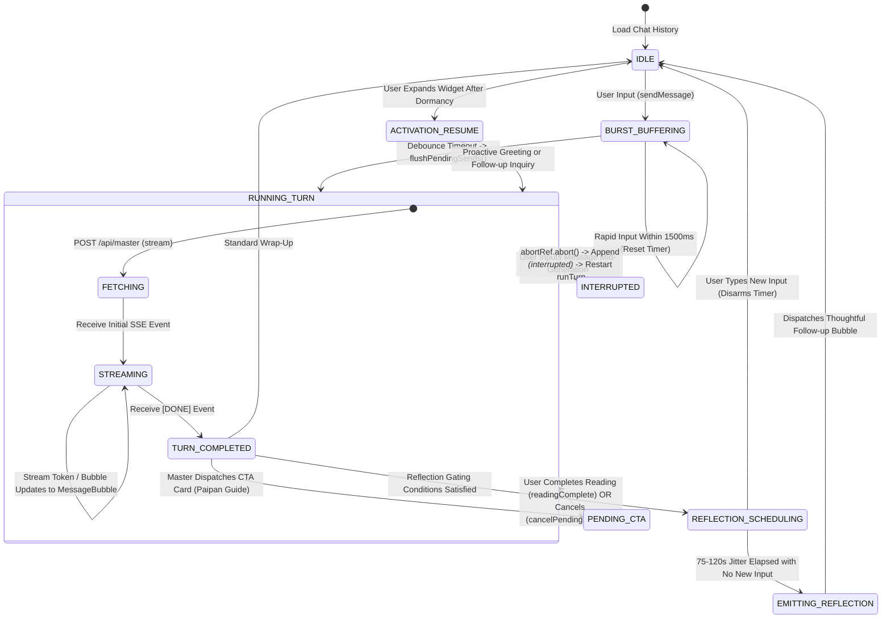
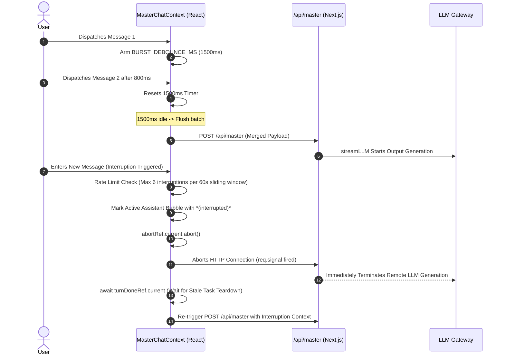

# XuanJi Master — Interaction Experience & State Machine Specifications

> **Version**: v2.1  
> **Level**: Conversational Interaction Architecture Manual  
> **Scope**: Interruption & Follow-up, CTA Card Lifecycle & Reversal, Idle Reflection, Activation Resume

---

## 1. Design Philosophy & Human-like Conversational Goals

"XuanJi Master" is not a passive question-and-answer customer support chatbot. It is engineered as a **calm, perceptive, modern metaphysical mentor with authentic conversational rhythm**.

Authentic human consultations exhibit non-asymmetric and dynamic characteristics:
- **Burst Messaging**: Users frequently send rapid fragments (e.g., typing "Are you there?" immediately followed by "Wanted to ask about my career this year").
- **Real-time Interruption**: While the master provides detailed analysis, users may notice a nuance to correct and interrupt mid-sentence.
- **Reflection**: After a conversational topic winds down, the master may experience a sudden realization 1-2 minutes later about a related natal chart detail.
- **Activation Resume**: When re-opening the consultation widget hours or days later, the master naturally resumes context based on prior discussions.

To support these interactions, the system employs a **state-driven conversational engine (Master Turn Engine)**.

---

## 2. Master Global Interaction Finite State Machine (FSM)



---

## 3. Four Core Interaction Mechanisms

### 1. Interruption & Follow-up

#### Business Scenarios
- **Scenario A (Interruption Mid-Generation)**: While the master is responding, the user interrupts: "Wait, I was asking about my partner's situation."
- **Scenario B (Rapid Follow-up In-Flight)**: Immediately after submitting a question, the user adds: "By the way, that birth date was lunar calendar."

#### Data Flow & Concurrency Sequence


#### Database Consistency & Storage Invariants
- **Zero Dirty State Persistence**: User messages are committed to `MasterChatMessage` **before** streaming initiates. Assistant responses are written **only upon stream completion**. If an interruption occurs mid-stream, the database contains user prompts without incomplete assistant records. The subsequent turn sends both user messages in sequence, allowing the model to naturally interpret the second message as a user correction or refinement.
- **Credit Billing**: Every `runTurn` consumes 1 Karma credit on the server. Interrupted restarts initiate a fresh turn, serving as a natural rate-limiting safeguard against malicious spamming.

---

## 2. CTA Card Lifecycle & Reversal

#### Business Scenario
When the master recommends computing a dedicated chart (e.g., "Click the card below to calculate your BaZi"), the conversation enters the `pendingReading` state. If the user decides not to proceed and dismisses the form, the master widget bottom bar exposes an explicit "Dismiss" action.

#### State Reversal Flow
1. User clicks the `[X]` button on the bottom bar, displaying a confirmation prompt.
2. Upon confirmation, `cancelPendingReading()` executes:
   - Clears the local `pendingReading` lock;
   - Injects a synthetic system notice: "Reading recommendation dismissed";
   - Triggers an automated conversational update: `runTurn({ silentPrompt: '[User dismissed the chart calculation prompt. Please acknowledge gently and continue naturally.]' })`;
3. The master processes this instruction to smoothly redirect the dialogue or reassure the user.

---

## 3. Idle Reflection (Spontaneous Realization Bubble)

#### Business Objective
Simulates an expert practitioner reviewing a natal chart in quiet contemplative study, proactively sharing an additional realization or nuance 75-120 seconds after completing a consultation turn.

#### Content-Aware Gating
To avoid unwanted disruptions, four strict preconditions must all be satisfied:
1. **Domain Relevance**: The preceding turn must discuss concrete astrological entities (BaZi, Zi Wei, decadal cycles, etc.); generic small talk does not trigger reflection.
2. **Non-terminal State**: The conversation must not have concluded with farewell markers (e.g., "Wishing you peace", "Take care").
3. **No Pending Actions**: No unresolved CTA cards in progress.
4. **Jittered Timing**: A delay is randomly selected within 75,000ms to 120,000ms. Any user keystroke during this window immediately disarms and terminates the timer.

---

## 4. Activation Resume

When a user returns and re-expands a collapsed consultation widget after several hours or overnight, the system activates a **two-stage resume heuristic**:

```
User Expands Chat Widget
       ↓
Check Inactivity Threshold (>2 hours elapsed with historical messages)
       ↓
┌─────────────────────────────────────────────────────────────┐
│ Stage 1: Deterministic Fast-Path                            │
│ Check if last assistant message contains an unresolved CTA: │
│   ├─ Completed in another browser tab -> Fire readingComplete│
│   └─ Pending past expiry -> Inquire if user requires help   │
└─────────────────────────────────────────────────────────────┘
       ↓ No Pending CTA
┌─────────────────────────────────────────────────────────────┐
│ Stage 2: Adaptive Contextual Engagement (LLM Driven)        │
│   ├─ Prior user message interrupted by network -> Resend    │
│   ├─ Major solar term transition (e.g. Lichun) -> Seasonal  │
│   └─ Prior conversation concluded naturally -> Remain silent│
└─────────────────────────────────────────────────────────────┘
```
