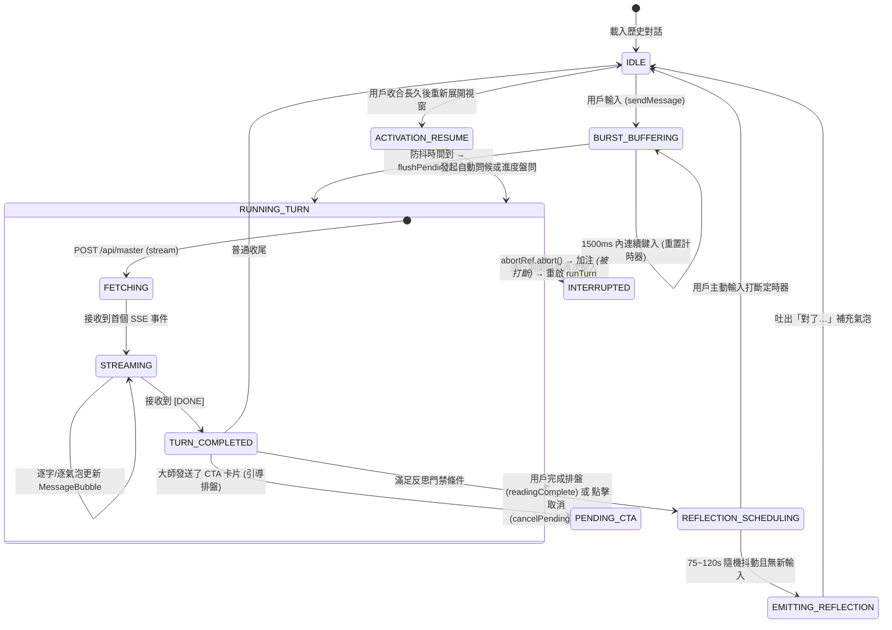
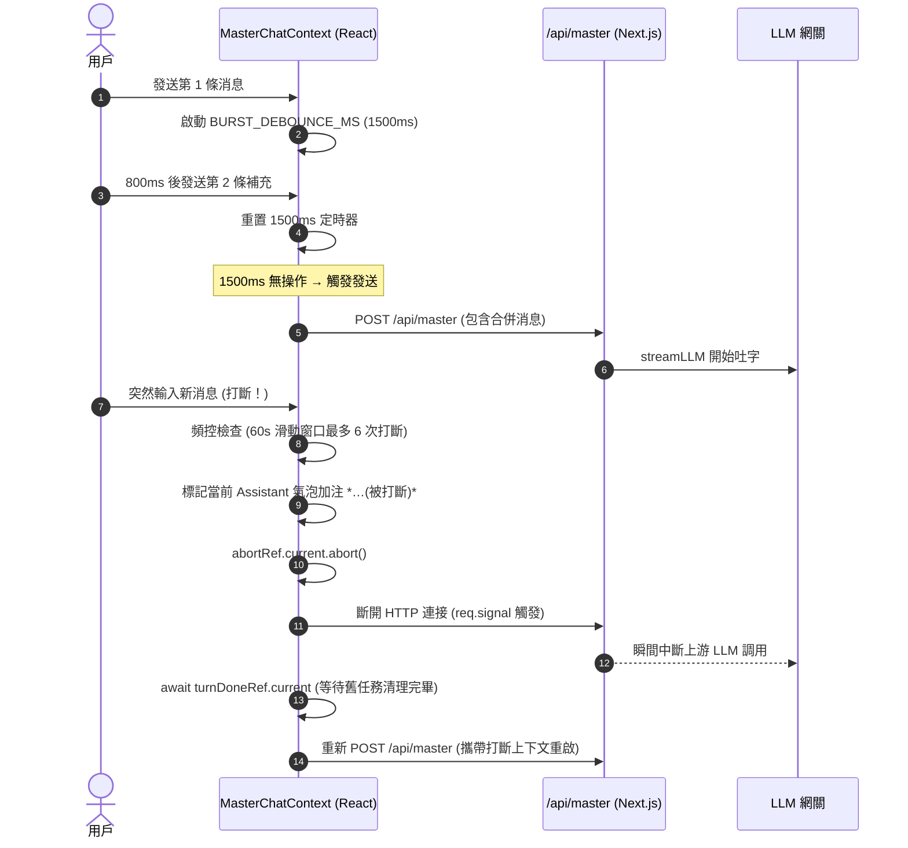

# 玄機大師 — 互動體驗機制與狀態機規範 (Master Interaction Features)

> **版本**：v2.1  
> **層級**：對話交互系統工程架構手冊 (Conversational Interaction Architecture)  
> **範圍**：打斷與追問、CTA 卡片生命週期與反轉、閒置智能反思、激活續接機制

---

## 一、設計理念與真人感交互目標

「玄機大師」並非傳統被動式「一問一答」的客服 Chatbot，其定位為一位**沈穩、有洞察力、且具備真實人際交互節奏的現代術數命理宗師**。

在人際交流中，真人對話具有非對稱性與動態特徵：
- **用戶會連發短消息**（Burst Send）：打完「在嗎」緊接著打「想問下今年事業」；
- **用戶會隨時插話打斷**（Interruption）：在大師長篇分析時，用戶可能發現重點偏移並立即追問；
- **對話會沉澱與反思**（Reflection）：聊完一段落後，大師可能在 1~2 分鐘後「突然想到」另一個關聯的命盤細節；
- **場景具備記憶與續接**（Activation Resume）：隔天展開視窗時，大師能依據昨天的進展自然開啟話題。

為支撐上述體驗，系統構建了**統一的狀態驅動交互引擎 (Master Turn Engine)**。

---

## 二、大師交互全局狀態機 (Global Interaction FSM)



---

## 三、四大核心交互機制詳解

### 1. 打斷與追問 (Interruption / Follow-up)

#### 業務場景
- **場景 A (LLM 輸出中插話)**：大師講到一半，用戶突然說「等等，我問的是我女朋友的事」；
- **場景 B (請求在空中補話)**：剛發送問題，用戶立馬補發「對了，我是農曆生日」。

#### 數據流與並發控制時序


#### 數據庫一致性保證
- **無髒數據寫入**：用戶消息在 Stream **啟動前**即刻寫入 `MasterChatMessage`；Assistant 消息僅在 Stream **完全成功閉合時**才寫入數據庫。打斷發生在中間時，數據庫只有用戶輸入而無半截 Assistant 記錄，下一次請求將兩條連續 User 消息作為上下文一併提交，模型自然視為「用戶補充更正」。
- **扣費策略**：每次 `runTurn` 均在服務端扣除 1 機緣點數。打斷重啟會消耗新額度，作為天然的防惡意刷屏機制。

---

### 2. CTA 卡片生命週期與反轉 (CTA Lifecycle & Reversal)

#### 業務場景
當大師建議用戶進行深度排盤（如「點擊下方卡片排八字」），對話進入 `pendingReading` 狀態。用戶若中途反悔關閉表單，大師底欄將提供顯式的「放棄」操作。

#### 狀態反轉流
1. 用戶點擊底欄 `[✕]` 按鈕，彈出確認對話框；
2. 確認取消後，調用 `cancelPendingReading()`：
   - 清除本地 `pendingReading` 鎖；
   - 插入一條虛擬系統通知：「已取消本次排盤引導」；
   - 自動合成觸發調用：`runTurn({ silentPrompt: '[用戶取消了本次排盤，請以溫和包容的語氣接話]' })`；
3. 大師接收該指令後，自動轉向其他話題或安撫情緒，對話無縫繼續。

---

### 3. 閒置智能反思 (Idle Reflection — 「對了…」氣泡)

#### 業務目標
在大師結束回答後，模擬真人命理師「看盤入神、靈光乍現」的思考過程，在 75~120 秒後主動追發一條短氣泡（1~2 句話）。

#### 內容感知門控 (Content-Aware Gating)
並非所有對話都能觸發反思。為防打擾，必須同時滿足四大嚴格門禁：
1. **話題相關性**：最後一輪對話必須涉及具體命盤（八字、紫微、大運等），純寒暄與問候不反思；
2. **非收尾狀態**：對話結尾不能包含「祝您順遂」、「保重」等告別標籤；
3. **無待決事項**：無進行中的 CTA 卡片；
4. **隨機抖動**：在 75,000ms ~ 120,000ms 區間隨機選取觸發時刻（Jittered Delay），若期間用戶有任何新打字動作，反思定時器立即自我銷毀。

---

### 4. 激活續接機制 (Activation Resume)

當用戶隔夜或數小時後重新展開已折疊的對話浮窗時，系統啟動**兩階段分流決策**：

```
用戶展開對話浮窗 (expand widget)
      ↓
檢查冷卻時間 (>2 小時且歷史消息 > 0)
      ↓
┌───────────────────────────────────────────────┐
│ Stage 1: 結構化確定性快徑 (Fast-Path)          │
│ 檢查最後一條 assistant 是否為待完成的 CTA 卡片   │
│   ├─ 是且已在其他分頁完成 → 觸發 readingComplete  │
│   └─ 是但超期未完成 → 提示是否需要協助          │
└───────────────────────────────────────────────┘
      ↓ 未命中 CTA
┌───────────────────────────────────────────────┐
│ Stage 2: 語義情境自適應搭話 (LLM Adaptive)      │
│   ├─ 上次用戶說了話但遇網絡中斷無回覆 → 主動補答│
│   ├─ 逢重大節氣更替 (立春/冬至) → 結合節令問候 │
│   └─ 對話已自然收尾 → 保持沈默，靜候用戶提問   │
└───────────────────────────────────────────────┘
```
