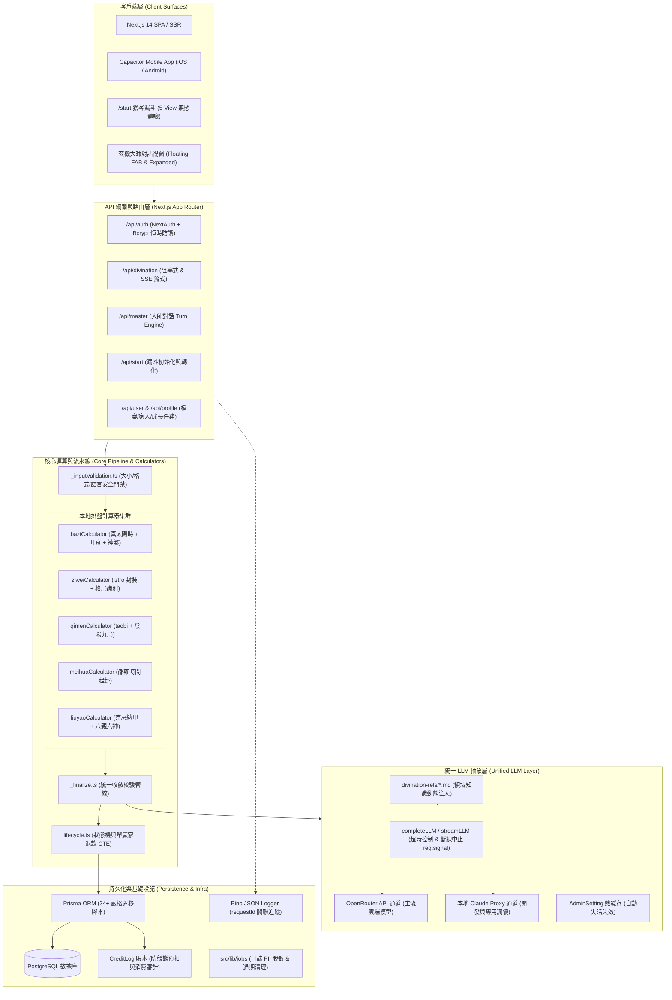

# 玄機 (Xuanji) — 系統架構與預測功能實現機制

> **版本**：v2.4 (2026-09 最新架構)  
> **維護者**：核心工程團隊 (Core Architecture & Engineering Team)  
> **地位**：系統權威架構白皮書（技術選型、數據流、子系統契約與架構不變量）

---

## 一、系統概覽與架構理念

「玄機」是一個原生構建於 AI 時代的中國傳統術數推演與現代心理諮詢平台。系統支持八大核心預測體系（八字、紫微斗數、奇門遁甲、六爻神卦、周易易經、梅花易數、風水堪輿、大六壬/綜合），並配備具備持久記憶與主動交互能力的「玄機大師」虛擬命理導師。

### 核心理念：確定性程序排盤 + 大語言模型語義解讀

在術數工程化領域，傳統純 LLM 解決方案面臨致命缺陷：**大語言模型無法穩定進行複雜的天文曆法換算、節氣切分與干支飛星矩陣推演**（極易產生嚴重幻覺與假排盤）。玄機平台的立足核心在於**硬邊界分工**：

```
[用戶輸入生辰/問題] 
       ↓
[確定性排盤引擎 (Calculators)] ──(100% 程式碼數學推導)──> [標準化命盤 JSON]
                                                                ↓
[統一 LLM 推理層 (Dual-Channel)] ──(注入專家知識 Prompt)───> [深度語義解讀]
                                                                ↓
[統一驗證流水線 (_finalize.ts)]  ──(Zod 結構校驗 + 結算)──> [流式/完整結果呈現]
```

### 系統架構不變量 (Architectural Invariants)

為確保系統在長期演進與高併發場景下的穩定性，架構定義了四大不可違背的全局約束：

1. **Invariant 1 (確定性排盤)**：所有天文節氣、真太陽時、干支四柱、十二宮曜、奇門九宮、六爻納甲排盤必須 100% 由本地 TypeScript 模組計算，輸入相同則輸出完全一致，嚴禁依賴 LLM 自行起卦或算盤。
2. **Invariant 2 (LLM 語義邊界)**：LLM 的角色定位純粹為「解盤者」與「諮詢引導者」。LLM 必須嚴格基於結構化命盤數據進行格局提煉、因果歸納與現代化生活轉譯，嚴禁修改或臆造排盤參數。
3. **Invariant 3 (雙通道等價性)**：HTTP 阻塞式調用與 SSE 流式傳輸是同一服務的兩種傳輸通道，兩者必須穿接相同的驗證管道（`_finalize.ts`），執行相同的硬拒絕門禁、Zod 結構校驗與賬本扣費邏輯。
4. **Invariant 4 (計費原子性與預扣保護)**：機緣（Karma）點數扣減嚴格採用 **Hold-then-Settle（預扣-結算）** 模式。解讀發起時原子預扣並鎖定在解讀記錄上；LLM 成功完成時預扣直接轉為消費；任何異常（超時、網絡中斷、進程崩潰、內容無效）均由生命週期服務全額原路退回，確保賬本絕對一致性。

---

## 二、總體架構全景圖



---

## 三、八大術數體系實現機制詳解

### 1. 八字命理 (BaZi / 四柱推命)
- **核心代碼**：`src/lib/baziCalculator.ts`、`src/lib/trueSolarTime.ts`
- **依賴基礎**：`lunar-typescript` 高精度天文曆法庫 + 本地經緯度均時差查表。
- **計算流程**：
  1. **真太陽時校正 (Equation of Time)**：依據出生地經緯度與日序計算均時差 $\Delta t = (L - 120^\circ) \times 4\text{min} + \text{EoT}$，精確判定跨時辰邊界（早子時/夜子時嚴格切分）。
  2. **四柱排定**：年柱以立春交節點（節氣精確時刻）為界；月柱依據節令切分；日柱天文精算；時柱依據五鼠遁推求。
  3. **藏干與五行加權**：十二地支按本氣(0.6)、中氣(0.3)、餘氣(0.1)分權重計算五行強度分佈。
  4. **格局與神煞主流化對標**：全面對齊《三命通會》與《子平真詮》標準（天乙貴人、月德、國印、德秀、天德合、紅艷煞等主流法則，由 `mainstreamAlignment.test.ts` 鎖定）。
  5. **大運流年**：按陰陽年男女順逆推算精確起運虛歲與交運時間（3天折1年，精確至月日時辰）。
- **LLM 注入**：加載 `divination-refs/bazi.md`，聚焦於喜用神調候、十神社會化心態、大運十步吉凶走向與現代事業健康指導。

### 2. 紫微斗數 (Zi Wei Dou Shu)
- **核心代碼**：`src/lib/ziweiCalculator.ts`、`src/lib/ziweiPatterns.ts`
- **依賴基礎**：開源 `iztro` 庫 + 70x 性能優化緩存架構。
- **計算流程**：
  1. **命身宮與五行局**：依據農曆出生月時定命宮身宮，依命宮干支推納音五行局（水二局至火六局）。
  2. **十四主星與群曜**：安放紫微、天府兩大星系，並布列六吉星、六煞星、生年四化（祿、權、科、忌）與天傷天使等雜曜。
  3. **廟旺平陷與格局偵測**：判定各宮星曜亮度，運行 `detectPatterns()` 辨識明珠出海、紫府同宮、殺破狼、三奇嘉會等經典命性格局。
- **LLM 注入**：加載 `divination-refs/ziwei.md`，重點解讀三方四正的星曜互涉、宮位飛化動態影響。

### 3. 奇門遁甲 (Qi Men Dun Jia)
- **核心代碼**：`src/lib/qimenCalculator.ts`
- **依賴基礎**：`taobi` 引擎 + VSOP87 高精度太陽黃經。
- **計算流程**：
  1. **陰陽遁與用局**：冬至後為陽遁，夏至後為陰遁；依據二十四節氣與日干支符頭推演上中下三元與一至九局。
  2. **天盤九星、人盤八門、神盤八神**：值符值使動態旋轉排布，六儀三奇天地盤對疊。
  3. **吉凶格自動判定**：青龍返首、飛鳥跌穴、玉女守門、三奇得門、六儀擊刑、奇門入墓（依據陰陽長生十二宮標準對齊）。
- **LLM 注入**：加載 `divination-refs/qimen.md`，分析問事宮與結果宮克應、決策時機與避凶策略。

### 4. 六爻神卦 (Liu Yao / 京房納甲)
- **核心代碼**：`src/app/api/divination/schemas/liuyao.schema.ts`、`src/lib/llm/prompts.ts`
- **計算流程**：
  1. **起卦方式**：支持手動搖卦（三次銅錢正反面記號 0~3）或時間/隨機起卦。
  2. **納甲與六親**：本卦與變卦配干支（京房八宮卦序），以本宮卦五行為我，配生我（父母）、我生（子孫）、克我（官鬼）、我克（妻財）、同我（兄弟）。
  3. **六神與世應**：日干起青龍、朱雀、勾陳、螣蛇、白虎、玄武；定世爻（自己）與應爻（對方/問事主體）。
- **LLM 注入**：加載 `divination-refs/liuyao.md`，以用神衰旺為核心，審查動爻生剋、月建日辰動態與應期推斷。

### 5. 周易易經 (I Ching)
- **核心代碼**：`src/app/api/divination/schemas/iching.schema.ts`
- **計算流程**：64 別卦推演、上下八卦（經卦）五行對應、六爻陰陽二進制編碼與變爻軌跡計算。
- **LLM 注入**：加載 `divination-refs/iching.md`，輸出標準卦辭、大象傳、爻辭原文及心理哲學現代啟示。

### 6. 梅花易數 (Mei Hua Yi Shu)
- **核心代碼**：`src/lib/meihuaCalculator.ts`
- **計算流程**：邵雍先天起卦法（年+月+日 mod 8 得上卦，+時 mod 8 得下卦，總數 mod 6 得動爻）；生成本卦、互卦、變卦；明確區分體卦與用卦，嚴格輸出五行生剋關係（體克用、用生體、體用比和等）。
- **LLM 注入**：加載 `divination-refs/others.md`，評估當前阻力、中期互卦徵兆與最終應期。

### 7. 風水堪輿 (Feng Shui)
- **核心代碼**：`src/app/api/divination/schemas/fengshui.schema.ts`
- **計算流程**：八宅法（東四宅/西四宅）與玄空飛星（三元九運，當前處於九運 2024-2043）；二十四山坐向排定山星與向星。
- **LLM 注入**：加載 `divination-refs/fengshui.md`，產出各房間能量分佈、財位文昌位吉凶及物理化解調理方案。

### 8. 六壬 / 其他綜合 (Liu Ren / Other)
- **核心代碼**：`src/app/api/divination/schemas/other.schema.ts`
- **計算流程**：天地盤互涉、日辰四課、三傳發端，適用於突發事件或綜合疑難推演。

---

## 四、機緣點數（Karma）計費與賬本架構

系統於 2026-06 全面廢除古老的每日請求次數限額，改由**強一致性、可審計的「機緣（Karma）點數賬本」**掌管一切價值流動。

### 1. 賬本核心實體 (`schema.prisma`)
- `User.credits`：用戶當前可用機緣餘額（`Int @default(0)`）。
- `Reading.creditsHeld`：解讀進行期間**原子預扣**並鎖定的機緣數額（`Int @default(0)`）。
- `CreditLog`：不可篡改的流水審計記錄表，包含 `action`（`register_bonus`, `divination_hold`, `divination_refund`, `master_turn`, `purchase`, `share_reward` 等）、變更數額 `amount` 及餘額快照 `balanceAfter`。

### 2. 預扣-結算事務時序 (Hold-then-Settle Flow)

```
[用戶點擊提交] 
      ↓
POST /api/divination/init
      ↓
[開展 Prisma 事務]
  ├─ 檢查 User.credits >= cost (不夠則 402 INSUFFICIENT_CREDITS)
  ├─ User.credits -= cost
  ├─ 創建 Reading (status: 'pending', creditsHeld: cost)
  └─ 記錄 CreditLog (action: 'divination_hold', amount: -cost)
      ↓
[客戶端接收 readingId，發起流式或阻塞式推演]
      │
      ├───────────────────────┬───────────────────────┐
      ▼                       ▼                       ▼
【成功完成】              【主動取消/超時】        【後端崩潰/LLM失敗】
  ↓                       ↓                       ↓
_finalize.ts           req.signal 中止         lifecycle.ts markFailed
  ↓                       ↓                       ↓
Reading.creditsHeld=0   Reading.creditsHeld=0   Reading.creditsHeld=0
Reading.status='done'   Reading.status='failed' Reading.status='failed'
User.credits 不變       User.credits += cost    User.credits += cost
                        CreditLog: refund       CreditLog: refund
```

### 3. 單贏家保證 (Single-Winner Concurrency Guarantee)
退款流程通過 SQL 原子條件更新保障冪等性：
```sql
UPDATE "Reading" 
SET "status" = 'failed', "creditsHeld" = 0, "updatedAt" = NOW() 
WHERE "id" = :id AND "status" = 'pending' AND "creditsHeld" > 0;
```
只有搶先奪得受影響行數 (`count === 1`) 的線程才獲准執行退款加回，徹底杜絕併發調用導致的重復退款。

---

## 五、LLM 抽象層與流式韌性架構

### 1. 雙通道適配器 (`src/lib/llm/`)
- **OpenRouter Gateway**：主力生產通道，支持動態配置模型（如 `anthropic/claude-3-5-sonnet`, `deepseek/deepseek-r1` 等）。內建帶 Jitter 的超時重試與 60 秒配置熱快取。
- **Claude Proxy Gateway**：本地直連代理，專供開發、除錯及專用私有化調優。
- **抽象出口**：全站代碼禁止直接調用 SDK，統一由 `completeLLM()` 與 `streamLLM()` 提供承載。

### 2. 韌性與可觀測性防線
- **全局 RequestId**：所有請求於入口由 `createRequestLogger` 生成短標識，貫穿日誌、LLM 接口調用、數據庫存儲（`LlmLog.requestId`）與 Sentry 上報。
- **斷線信號傳遞 (`req.signal`)**：當用戶關閉瀏覽器標籤或點擊取消時，`req.signal` 自動向下游 OpenRouter/Claude 發送 Abort 信號，瞬間中止 LLM 算力消耗。
- **超長調用進度漸進 (Honest Progress)**：LLM 推理超時超 180 秒時，進度條啟動漸進算法（95%→99%），並動態提示「深度推理中（已耗時 N 分鐘）」；超過 300 秒暴露「取消並保留表單草稿」按鈕。
