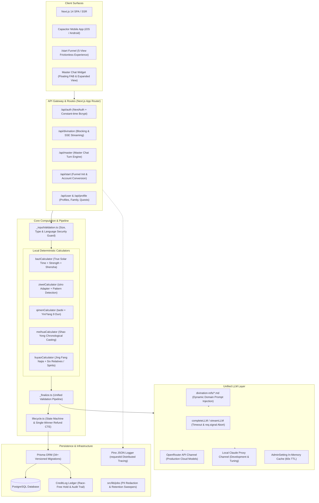

# XuanJi — System Architecture & Prediction Implementation Mechanics

> **Version**: v2.4 (2026-09 Architecture Baseline)  
> **Maintainer**: Core Architecture & Engineering Team  
> **Status**: Authoritative System Architecture Whitepaper (Tech Stack, Data Flows, Subsystem Contracts, and Architectural Invariants)

---

## 1. System Overview & Core Philosophy

"XuanJi" is an AI-native Chinese metaphysical divination and modern counseling platform. The system supports eight core prediction methodologies (BaZi, Zi Wei Dou Shu, Qi Men Dun Jia, Liu Yao, I Ching, Mei Hua Yi Shu, Feng Shui, and Da Liu Ren / Comprehensive), paired with the "XuanJi Master" persistent virtual metaphysical mentor.

### Core Architecture: Deterministic Calculation + LLM Semantic Interpretation

In metaphysical software engineering, pure LLM approaches exhibit a critical flaw: **Large language models cannot reliably calculate astronomical ephemerides, solar term cutoffs, or complex Heavenly Stem / Earthly Branch and Flying Star matrices** (leading to severe hallucinations and corrupted charts). XuanJi enforces a **strict boundary separation**:

```
[User Birth Input / Query] 
       ↓
[Deterministic Engines (Calculators)] ──(100% Code Mathematical Derivation)──> [Standard Chart JSON]
                                                                                      ↓
[Unified LLM Reasoning Layer]          ──(Dynamic Domain Prompt Context)───> [Deep Semantic Analysis]
                                                                                      ↓
[Unified Validation Pipeline]          ──(Zod Schema Validation + Settle)──> [Stream / Complete Result]
```

### Architectural Invariants

To guarantee platform stability during continuous evolution and under high concurrency, four global invariants are strictly enforced:

1. **Invariant 1 (Deterministic Paipan)**: All astronomical solar terms, true solar time adjustments, four pillars Gan-Zhi, twelve palace stars, Qi Men nine-palace boards, and Liu Yao Najia alignments must be 100% computed by local TypeScript modules. Identical inputs yield identical outputs. LLMs are prohibited from casting hexagrams or computing natal charts.
2. **Invariant 2 (LLM Semantic Boundary)**: The LLM functions strictly as an "interpreter" and "dialogue counselor". The LLM must reason exclusively over structured chart data to extract formations, synthesize causal chains, and translate insights into modern actionable guidance. Modifying or fabricating chart coordinates is forbidden.
3. **Invariant 3 (Dual-Channel Equivalence)**: HTTP blocking calls and SSE streaming feeds represent two transport adapters for the same underlying pipeline. Both must pass through the identical validation pipeline (`_finalize.ts`), enforcing identical hard rejection criteria, Zod structural validation, and ledger settlement rules.
4. **Invariant 4 (Billing Atomicity & Reservation Protection)**: Karma credits strictly utilize a **Hold-then-Settle** ledger lifecycle. Upon initiation, credits are atomically held and locked to the pending reading. Once the LLM completes and validates successfully, held credits transition to consumed. Any failure (timeout, network disconnection, crash, or validation failure) triggers a full atomic refund via the lifecycle service, guaranteeing zero credit loss.

---

## 2. Global Architecture Diagram



---

## 3. Eight Divination Systems Implementation

### 1. BaZi (Four Pillars of Destiny)
- **Core Implementation**: `src/lib/baziCalculator.ts`, `src/lib/trueSolarTime.ts`
- **Dependencies**: `lunar-typescript` / `tyme4ts` high-precision astronomical calendar + local coordinate Equation of Time lookup.
- **Derivation Pipeline**:
  1. **True Solar Time Correction**: Uses birth longitude and calendar day to calculate Equation of Time: $\Delta t = (L - 120^\circ) \times 4\text{min} + \text{EoT}$, strictly determining early Zi (00:00-01:00) vs late Zi (23:00-24:00) hour transitions.
  2. **Four Pillars Casting**: Year Pillar defined by the exact astronomical Lichun (solar term) instant; Month Pillar derived from solar terms; Day Pillar computed astronomically; Hour Pillar derived via the Five Rat Sequence.
  3. **Hidden Stems & Weighted Five Elements**: Earthly branches allocate Five Element weights across Major (0.6), Secondary (0.3), and Residual (0.1) Qi.
  4. **Formation & Shensha Mainstream Alignment**: Fully aligned with *San Ming Tong Hui* and *Zi Ping Zhen Quan* standards (Tian Yi Nobleman, Yue De, Guo Yin, De Xiu, Tian De He, Hong Yan Sha, locked by `mainstreamAlignment.test.ts`).
  5. **Decadal & Annual Luck**: Calculates precise luck inception age and handover timestamp based on stem polarity and gender (3 days = 1 year, down to day and hour).
- **LLM Prompt Injection**: Loads `divination-refs/bazi.md`, focusing on favorable/unfavorable elements (Xi Yong Shen), climatic balance (Tiao Hou), social psychology, decadal trajectory, and career/health analysis.

### 2. Zi Wei Dou Shu (Purple Star Astrology)
- **Core Implementation**: `src/lib/ziweiCalculator.ts`, `src/lib/ziweiPatterns.ts`
- **Dependencies**: `iztro` library + 70x acceleration caching layer.
- **Derivation Pipeline**:
  1. **Life/Body Palaces & Five Elements Bureau**: Identifies Life and Body Palaces from lunar birth month and hour; computes Five Elements Bureau (Water 2 to Fire 6) from Life Palace stem-branch Nayin.
  2. **Fourteen Primary Stars & Minor Stars**: Positions Ziwei and Tianfu star systems, auxiliary auspicious/inauspicious stars, birth Si Hua mutagens (Lu, Quan, Ke, Ji), and minor stars.
  3. **Brightness & Pattern Detection**: Evaluates star brightness (Temple, Brilliance, Ground, Trap) and invokes `detectPatterns()` to identify classical configurations (e.g., Pearl Emerging from the Sea, Zi Wei and Tian Fu in Same Palace, Sha-Po-Lang, Three Auspicious Meetings).
- **LLM Prompt Injection**: Loads `divination-refs/ziwei.md`, analyzing mutual interactions across the Three Parties and Four Adjacent Palaces and palace mutagen flying transformations.

### 3. Qi Men Dun Jia (Mysterious Gates)
- **Core Implementation**: `src/lib/qimenCalculator.ts`
- **Dependencies**: `taobi` engine + VSOP87 high-precision solar longitude.
- **Derivation Pipeline**:
  1. **Yin/Yang Dun & Ju Configuration**: Winter Solstice begins Yang Dun; Summer Solstice begins Yin Dun. Derives Upper, Middle, Lower epochs and Dun numbers 1-9 from 24 solar terms and day stem-branch heads.
  2. **Heavenly Plate Nine Stars, Human Plate Eight Gates, Spirit Plate Eight Deities**: Rotates Zhi Fu and Zhi Shi dynamic plates and overlays Six Instruments and Three Nobles across Heaven and Earth plates.
  3. **Pattern Recognition**: Automatically evaluates Green Dragon Turning Head, Flying Bird Falling into Cave, Jade Maiden Guarding Door, Three Nobles Obtaining Gate, Six Instruments Strike Punishment, and Noble Enters Grave.
- **LLM Prompt Injection**: Loads `divination-refs/qimen.md`, evaluating question vs outcome palace resonance, optimal timing windows, and strategic remedies.

### 4. Liu Yao (Six Lines / Jing Fang Najia)
- **Core Implementation**: `src/app/api/divination/schemas/liuyao.schema.ts`, `src/lib/llm/prompts.ts`
- **Derivation Pipeline**:
  1. **Casting Mechanism**: Supports manual coin tosses (three coins, outcomes 0~3) or timestamp/random generation.
  2. **Najia & Six Relatives**: Assigns stems and branches to original and transformed hexagrams (Jing Fang Eight Palace sequence). The palace Five Element serves as self, mapping Parent, Offspring, Officer/Ghost, Wealth, and Sibling.
  3. **Six Spirits & Host/Guest Lines**: Day stem assigns Azure Dragon, Vermilion Bird, Hook Chen, Flying Serpent, White Tiger, and Black Tortoise. Designates Subject (Self) and Object (Target) lines.
- **LLM Prompt Injection**: Loads `divination-refs/liuyao.md`, evaluating Useful God (Yong Shen) strength, active line interactions, monthly/daily energetic support, and manifestation timing (Ying Qi).

### 5. I Ching (Book of Changes)
- **Core Implementation**: `src/app/api/divination/schemas/iching.schema.ts`
- **Derivation Pipeline**: Computes 64 hexagram derivations, upper/lower trigram Five Element correspondences, binary yin-yang line encoding, and changing line trajectories.
- **LLM Prompt Injection**: Loads `divination-refs/iching.md`, rendering canonical Hexagram Judgements, Great Image Commentaries, original line verses, and modern philosophical reflections.

### 6. Mei Hua Yi Shu (Plum Blossom Divination)
- **Core Implementation**: `src/lib/meihuaCalculator.ts`
- **Derivation Pipeline**: Shao Yong primordial casting method (Year + Month + Day mod 8 for Upper Trigram, + Hour mod 8 for Lower Trigram, total sum mod 6 for Moving Line); derives Natal, Mutual, and Transformed Trigrams; distinguishes Subject Trigram from Object Trigram with strict Five Element generation/restriction cycles.
- **LLM Prompt Injection**: Loads `divination-refs/others.md`, evaluating current resistance, intermediate signs from mutual trigrams, and outcome timing.

### 7. Feng Shui
- **Core Implementation**: `src/app/api/divination/schemas/fengshui.schema.ts`
- **Derivation Pipeline**: Eight Mansions (East/West Four Mansions) and Xuan Kong Flying Stars (Three Cycles & Nine Periods; Period 9: 2024-2043); evaluates 24-mountain sitting/facing alignments for Mountain and Water stars.
- **LLM Prompt Injection**: Loads `divination-refs/fengshui.md`, generating spatial energy distributions, wealth and academic sector assessments, and physical remediation cures.

### 8. Da Liu Ren & Comprehensive Synthesis
- **Core Implementation**: `src/app/api/divination/schemas/other.schema.ts`
- **Derivation Pipeline**: Heaven and Earth plate alignments, daily stem Four Lessons, Three Transmissions derivation, serving emergent multi-factor inquiries.

---

## 4. Karma Credit Economy & Ledger Architecture

The system utilizes an auditable, strongly consistent **Karma Credit Ledger** to govern all value exchange.

### 1. Core Schema Entities (`schema.prisma`)
- `User.credits`: Available Karma balance (`Int @default(0)`).
- `Reading.creditsHeld`: Held Karma balance **atomically reserved** during in-flight readings (`Int @default(0)`).
- `CreditLog`: Immutable audit ledger recording transaction `action` (`register_bonus`, `divination_hold`, `divination_refund`, `master_turn`, `purchase`, `share_reward`), change `amount`, and post-transaction balance snapshot `balanceAfter`.

### 2. Hold-then-Settle Lifecycle Sequence

```
[User Submits Form] 
       ↓
POST /api/divination/init
       ↓
[Prisma Atomic Transaction]
  ├─ Verify User.credits >= cost (or return 402 INSUFFICIENT_CREDITS)
  ├─ User.credits -= cost
  ├─ Create Reading (status: 'pending', creditsHeld: cost)
  └─ Record CreditLog (action: 'divination_hold', amount: -cost)
       ↓
[Client Receives readingId, Initiates SSE or Blocking Call]
       │
       ├───────────────────────┬───────────────────────┐
       ▼                       ▼                       ▼
[Successful Completion]   [Client Cancel / Abort]   [Server Crash / LLM Error]
   ↓                       ↓                         ↓
_finalize.ts            req.signal abort          lifecycle.ts markFailed
   ↓                       ↓                         ↓
Reading.creditsHeld=0   Reading.creditsHeld=0     Reading.creditsHeld=0
Reading.status='done'   Reading.status='failed'   Reading.status='failed'
User.credits unchanged  User.credits += cost      User.credits += cost
                        CreditLog: refund         CreditLog: refund
```

### 3. Single-Winner Concurrency Guarantee
The refund pipeline guarantees idempotency through atomic conditional updates:
```sql
UPDATE "Reading" 
SET "status" = 'failed', "creditsHeld" = 0, "updatedAt" = NOW() 
WHERE "id" = :id AND "status" = 'pending' AND "creditsHeld" > 0;
```
Only the specific execution thread obtaining `count === 1` is authorized to process the refund credit restore, preventing double-refund race conditions.

---

## 5. Unified LLM Layer & Streaming Resilience

### 1. Dual-Channel Adapters (`src/lib/llm/`)
- **OpenRouter Gateway**: Primary production channel supporting dynamic model dispatch (`anthropic/claude-3-5-sonnet`, `deepseek/deepseek-r1`). Features jittered retries and a 60-second in-memory config cache.
- **Claude Proxy Gateway**: Local direct proxy tailored for local development, offline debugging, and private fine-tuning.
- **Unified Interface**: Direct SDK instantiation is prohibited in application code. All operations flow through `completeLLM()` and `streamLLM()`.

### 2. Resilience & Observability
- **Global RequestId**: Every request receives a short identifier via `createRequestLogger`, propagating through application logs, LLM calls, database records (`LlmLog.requestId`), and Sentry events.
- **Client Disconnect Signal (`req.signal`)**: When a user closes their tab or aborts a request, `req.signal` propagates an abort signal downstream to OpenRouter/Claude, terminating remote compute consumption.
- **Progressive Feedback (Honest Progress)**: When LLM reasoning exceeds 180 seconds, the client UI activates an asymptotic progress animation (advancing from 95% toward 99%) accompanied by an informative notice; after 300 seconds, an explicit "Cancel and Retain Draft" action appears.
