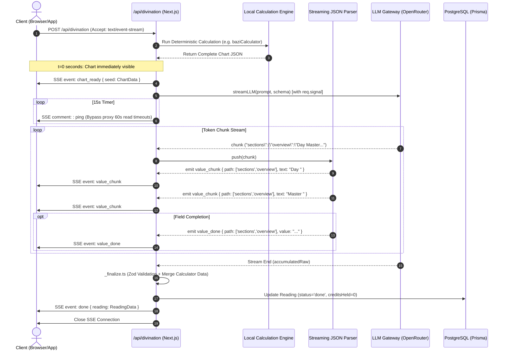
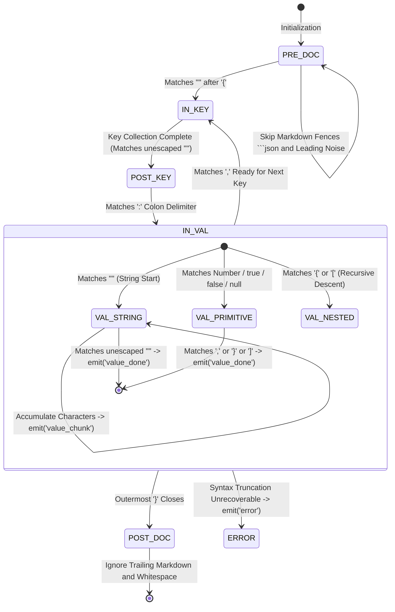

# Streaming Divination — Architecture & Protocol Specification

> **Version**: v2.2  
> **Level**: Core Streaming Pipeline Engineering Specification  
> **Scope**: Backend SSE Transport, Character-level Streaming JSON FSM, Frontend Progressive Rendering, and Network Fault Tolerance

---

## 1. Design Goals & Architectural Boundaries

In traditional AI divination applications, reading generation suffers from severe latency bottlenecks: generating a deep 4,000 to 8,000 word chart interpretation can take **60 to 180 seconds** of LLM inference time. On mobile devices or acquisition landing pages, a blank loading state during this duration causes >65% user bounce.

XuanJi's streaming architecture provides:
1. **$t=0$ Deterministic Chart Immediate Render**: Before the first token arrives from the remote LLM, the local calculation engine derives the natal chart structure (Four Pillars, Ten Gods, Decadal Cycles, Twelve Palaces, Nine Palaces) and delivers it instantaneously to render the chart UI immediately.
2. **Character-level Progressive Typewriter Rendering**: The incoming JSON text stream emitted by the LLM is parsed incrementally into an object tree in real time. Each interpretation section (Overview, Career, Romance, Wealth) emerges progressively with synchronized typewriter animations across dedicated cards.
3. **Resilient Network & Proxy Handling**: 15-second mandatory SSE keep-alive heartbeats, edge proxy timeout protection, client cancellation signal (`req.signal`) propagation to terminate remote inference, and atomic credit refund pipelines.

---

## 2. End-to-End Streaming Sequence



---

## 3. Streaming JSON Parser State Machine

- **Core Implementation**: `src/app/api/divination/handlers/_streamingJsonParser.ts`
- **Design Philosophy**: Standard `JSON.parse` requires a fully terminated string before parsing. `StreamingJsonParser` operates as a **path-aware character-level Finite State Machine (Char-level FSM)** that extracts accumulating string fragments along JSON paths before the syntax tree has completed.

### State Transition Diagram



### Event and Payload Specifications

| Event Type | Trigger Condition | Payload Schema | Client Handling Strategy |
|---|---|---|---|
| `chart_ready` | Paipan calculation complete, before LLM starts ($t=0$) | `{ type: 'chart_ready', seed: Object }` | Writes chart data to root state, immediately rendering the chart UI. |
| `value_chunk` | String attribute receives new incoming characters | `{ path: (string\|number)[], text: string }` | Traverses `path` and appends text with RAF throttling. |
| `value_done` | String/Number/Boolean field finishes | `{ path: (string\|number)[], value: any }` | Sets the finalized value at the designated path. |
| `done` | Server `_finalize.ts` validation and persistence complete | `{ type: 'done', reading: Object, saved: true }` | Replaces partial client snapshot with authoritative validated data. |
| `error` | Connection drop, rejection gate, or runtime failure | `{ type: 'error', error: string, status?: number }` | Halts progress animations and displays error state / retry actions. |

---

## 4. Progressive Rendering & RAF Throttling

- **Core Implementation**: `src/app/divination/[type]/page.tsx`, `src/components/results/ResultRenderer.tsx`
- **Frequent Re-render Mitigation**: LLM chunks may contain only 1-3 characters. If each `value_chunk` event fired React `setState`, it would cause 30-80 reconciliations per second, producing noticeable frame drops on mobile devices.
- **Architectural Solution**:
  1. **In-place Mutation (`mutateAtPath`)**: Maintains a single partial object ref (`partialRef`). Mutates leaf nodes directly in place along `path` arrays, eliminating per-frame deep clone garbage collection.
  2. **requestAnimationFrame (RAF) Throttling**: Batches incoming token events within a single animation frame via `requestAnimationFrame` locked to a maximum 60fps refresh rate.
  3. **Adaptive Vertical Layout in ResultRenderer**: When `streaming=true`, tabbed navigation is disabled, switching analysis cards to an auto-scrolling vertical layout for typewriter rendering.

---

## 5. Fault Tolerance & Disconnection Resilience

### 1. 15-Second Server Keep-Alive Heartbeat
Cloud reverse proxies (e.g., Cloudflare, Nginx, AWS ALB) terminate HTTP connections if no bytes are transferred for 60 seconds. Because reasoning models (e.g., DeepSeek-R1, Claude extended thinking) can exhibit time-to-first-token (TTFT) delays of 30-50 seconds, the backend SSE pipeline runs a **15-second unconditional heartbeat timer**:
```typescript
const heartbeatInterval = setInterval(() => {
  safeWrite(': ping\n\n');
}, 15_000);
```

### 2. Client Cancellation Signal Propagation (`req.signal`)
When a user clicks "Cancel" or closes their browser tab, Next.js catches `req.signal.aborted` and terminates remote compute:
$$\text{Browser Abort} \xrightarrow{\text{req.signal}} \text{Route Handler} \xrightarrow{\text{AbortSignal}} \text{OpenRouter SDK} \xrightarrow{} \text{Cease Token Generation}$$
Simultaneously, `lifecycle.ts` executes `refundHold()` to atomically refund held Karma credits to the user.

### 3. Progressive Feedback & Draft Preservation
For complex interpretations exceeding 180 seconds:
- **Asymptotic Progress Animation (95% to 99%)**: The progress bar smoothly decelerates toward 99% using an asymptotic logarithmic curve accompanied by an informative notice.
- **Draft Recovery After 300 Seconds**: If generation exceeds 5 minutes, an explicit cancellation button appears, restoring the backed-up form draft from `localStorage` so user input is never lost.
