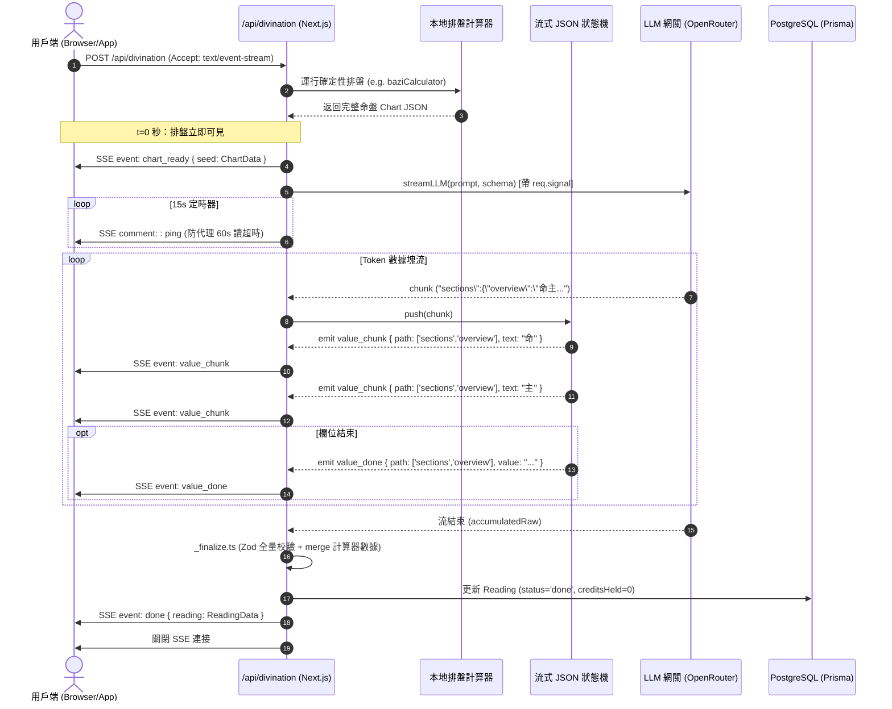
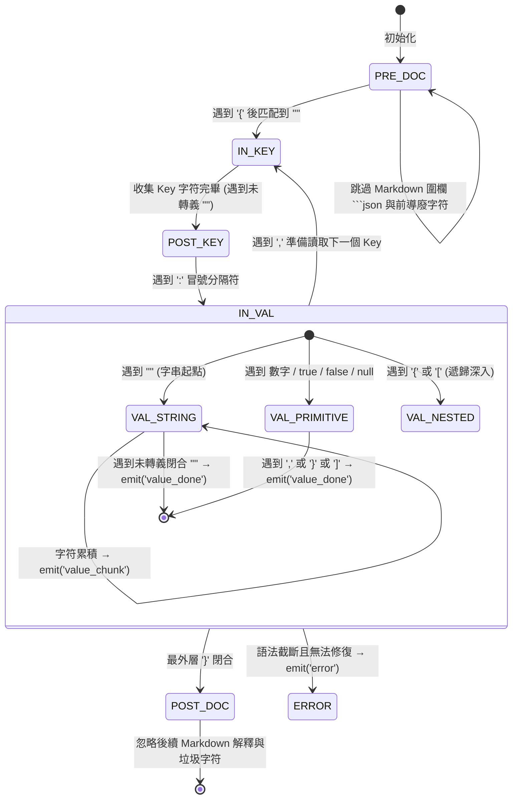

# 占卜流式渲染 (Streaming Divination) — 架構與協議規範

> **版本**：v2.2  
> **層級**：核心交互與流式管道工程規範 (Core Streaming Pipeline Specification)  
> **範圍**：後端 SSE 傳輸、字符級流式 JSON 狀態機、前端漸進式渲染與斷線容錯

---

## 一、設計目標與架構邊界

在傳統 AI 命理產品中，解盤面臨嚴重的等待體驗瓶頸：生成一篇 4000~8000 字的深度命盤解讀，LLM 推理延遲高達 **60~180 秒**。在移動端或廣告著陸頁，這段時間內的空白加載會導致 >65% 的用戶流失。

玄機平台的流式渲染架構旨在實現：
1. **$t=0$ 秒確定性排盤秒級直出**：在 LLM 首個 Token 到達前，排盤引擎計算的命盤結構（四柱、十神、大運、十二宮曜、九宮格）瞬間發送並完全渲染；
2. **字符級增量打字體驗**：LLM 吐出的 JSON 文本流被實時解析為對象樹，各章節解讀（總覽、事業、婚戀、財運）以逐字打字動效在各自卡片中同步漸進湧現；
3. **極致網絡與代理韌性**：15 秒強制 SSE 心跳保持、代理超時防禦、客戶端中止信號（`req.signal`）穿透中止上游 LLM，以及原子退款機制。

---

## 二、端到端流式時序圖 (End-to-End Sequence)



---

## 三、流式 JSON 解析狀態機 (Streaming JSON Parser)

- **核心源碼**：`src/app/api/divination/handlers/_streamingJsonParser.ts`
- **設計哲學**：標準 `JSON.parse` 必須等待全文字符閉合才能解析，而 `StreamingJsonParser` 是一個**路徑感知的字符級有限狀態機 (Char-level FSM)**，能夠在 JSON 語法樹尚未構建完畢時，沿著路徑提取出正在累積的字串碎片。

### 狀態機轉移圖



### 事件與數據載荷規格

| 事件類型 | 觸發時機 | 載荷格式 (`Payload`) | 前端處理策略 |
|---|---|---|---|
| `chart_ready` | 排盤計算完成，LLM 未啟動前 ($t=0$) | `{ type: 'chart_ready', seed: Object }` | 直接將計算盤面寫入根狀態，展示排盤 UI |
| `value_chunk` | 某個字串屬性正在流入新的字符片斷 | `{ path: (string\|number)[], text: string }` | 沿 `path` 尋址，使用 RAF 節流附加到末尾 |
| `value_done` | 一個字串/數字/布林值完整結束 | `{ path: (string\|number)[], value: any }` | 將最終值固定在指定路徑上 |
| `done` | 後端 `_finalize.ts` 驗證與存庫完成 | `{ type: 'done', reading: Object, saved: true }` | 用服務端完全校驗的權威數據替換局部快照 |
| `error` | 傳輸中斷、拒絕門禁觸發或底層異常 | `{ type: 'error', error: string, status?: number }` | 停止進度條，顯示重試或錯誤提示 |

---

## 四、前端漸進式渲染與 RAF 節流

- **核心源碼**：`src/app/divination/[type]/page.tsx`、`src/components/results/ResultRenderer.tsx`
- **高頻重繪問題**：LLM 每個 Token 可能僅有 1~3 個字符，若每次 `value_chunk` 事件均觸發 React `setState`，每秒會產生 30~80 次 React Reconciliation，在移動設備上導致嚴重掉幀。
- **架構方案**：
  1. **就地尋址修改 (`mutateAtPath`)**：維護單一局部對象 `partialRef`，沿 `path` 陣列直接就地修改葉節點，杜絕每幀深度 Clone 的內存分配垃圾回收；
  2. **requestAnimationFrame (RAF) 節流**：在 `scheduleRender` 中通過 `requestAnimationFrame` 鎖定最大 60fps 刷新頻率，將一幀內抵達的多個 Token 批處理合流。
  3. **ResultRenderer 縱向平鋪自適應**：在 `streaming=true` 模式下，強行禁用 Tab 分頁，將各分析卡片切換為縱向平鋪流式打字佈局。

---

## 五、異常處置與斷線韌性架構

### 1. 15秒服務端主動心跳保持
多數雲端反向代理（如 Cloudflare、Nginx、AWS ALB）在 60 秒無數據傳輸時會自動切斷 HTTP 連接。由於大型推理模型（如 DeepSeek-R1、Claude 思考模式）首字節延遲（TTFT）可能長達 30~50 秒，後端 SSE 管道啟動了 **15秒無條件心跳定時器**：
```typescript
const heartbeatInterval = setInterval(() => {
  safeWrite(': ping\n\n');
}, 15_000);
```

### 2. 客戶端中止與信號穿透 (`req.signal`)
當用戶主動點擊「取消」或關閉分頁時，瀏覽器中斷 HTTP 連接，Next.js API 捕獲 `req.signal.aborted`，並沿以下鏈路瞬間終止：
$$\text{Browser Abort} \xrightarrow{\text{req.signal}} \text{Route Handler} \xrightarrow{\text{AbortSignal}} \text{OpenRouter SDK} \xrightarrow{} \text{中止計費 Token 產生}$$
同時觸發 `lifecycle.ts` 的 `refundHold()`，將預扣機緣原子歸還用戶。

### 3. 超長調用「誠實進度條」與草稿保留
針對超過 180 秒的超長解卦：
- **95%~99% 漸進算法**：進度條絕不卡死在 95%，而是按漸進對數曲線緩慢爬升至 99%，並動態顯示「深度推理中（已耗時 N 分鐘）」；
- **300秒取消與表單恢復**：超過 5 分鐘後，提供顯式的取消按鈕，自動讀取 `localStorage` 備份的表單草稿，保證用戶退回表單時已填信息 100% 完整無失。
